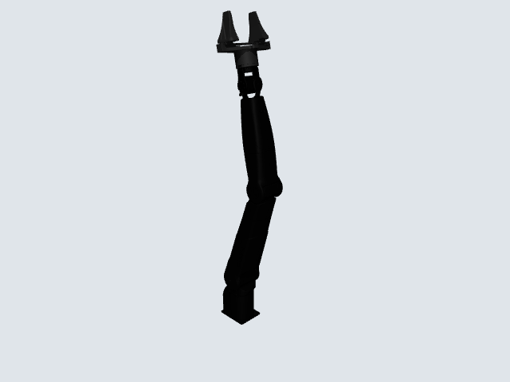
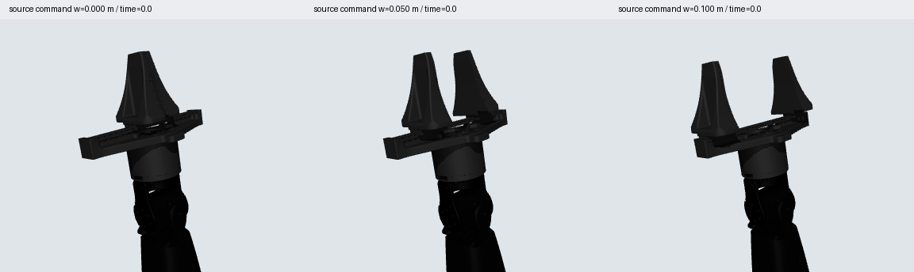

# NERO + 官方两指夹爪仿真资产

本仓库统一维护静态机械资产、动力学控制和物理接触验证。唯一工程为 `LeoandDream/Nero_Gripper_assets`；当前新增功能在 `feature/dynamic-control`，完整抓取仍未验收，尚未合并main。

以厂商URDF/Xacro为机械依据。来源锁定 [agx_arm_urdf@a68b8e8](https://github.com/agilexrobotics/agx_arm_urdf/tree/a68b8e876a2c6fcb0ecee7a7943129e4d48dd864)，采用该版本的官方法兰、夹爪基座和两指模型。

```text
urdf/       相对路径展开URDF；source保留官方原字节
mjcf/       保留实体机械字段的MuJoCo模型
meshes/     原始DAE/STL、派生可视OBJ与分量凸碰撞体
examples/   静态查看入口
experiments/dynamics/   最小控制器、运行入口和冻结配置（复用根目录机械资产）
tests/      原静态测试及统一入口测试
scripts/    统一测试入口、离线重建与独立URDF核对
reports/    各验证层报告、审查、历史证据归档和预览
docs/       接口、构建方法与模型边界
licenses/   官方MIT许可及来源
```

## 查看

首次克隆并建立运行环境：

```bash
git clone --branch feature/dynamic-control https://github.com/LeoandDream/Nero_Gripper_assets.git
cd Nero_Gripper_assets
python3.11 -m venv .venv
.venv/bin/pip install -r requirements.txt
```

在仓库根目录运行：

```bash
.venv/bin/python examples/view_static.py
.venv/bin/python examples/view_static.py --collision
```

无桌面服务器可导出静态图片：

```bash
MUJOCO_GL=egl .venv/bin/python examples/view_static.py --image preview.png
MUJOCO_GL=egl .venv/bin/python examples/view_static.py --width 0 --image closed.png
```

`--width` 是源URDF的虚拟开合命令坐标，范围0..0.1米；两指分别取其±一半。这不是经过真机标定的实际指尖净间距。查看器只设置姿态、调用 `mj_forward` 并显示，不积分物理、不执行策略。

`meshes/visual`只保留OBJ网格。各部件采用源材料中面积占比最大的颜色作为直接RGBA材质，省去外部贴图；原来的局部多色和标识配色被简化，原始DAE仍保留。



## 已验证范围

- 官方29项源文件逐字节保存，Git blob ID与SHA256可复核。
- 12个实体部件、9个标量关节、1个双指线性约束，纯静态参考配置执行器数量0；派生动态配置新增9个内部servo。原URDF额外的空虚拟命令关节在MJCF中消去；具体映射见 [接口契约](docs/robot-contract.json)。
- 11组合法静态配置独立核对源URDF前向运动学、质量/惯性、安装变换、关节轴/范围和可视/碰撞包围边界；结果见 [原始报告](reports/static-validation.json)。
- 总质量5.12892366kg；质量、惯性中心、轴和限位核对误差0，完整惯性重建最大误差约1.73e-18 kg·m²。几何边界最大误差约9.27e-9m，属于浮点转换核对值，不代表接触精度。
- MuJoCo3.2.3完成上述静态核对；当前LIBERO环境的2.3.7另行通过编译及参考姿态 `mj_forward`，该兼容性检查范围见 [报告](reports/libero-engine-compatibility.json)。
- 8项测试通过，涵盖源字节、虚拟关节消去、mimic、独立静态核对、迁移后编译、查看器，以及源参考被同时篡改和碰撞mask清零的拒绝反例；详细记录见 [验证记录](reports/tests.txt)。独立审查与两项补强见 [审查记录](reports/review.md)。



## 接触和控制边界

碰撞体为62个源分量凸包，原STL和原DAE均保留。凸包仍会填充源凹部；所有源碰撞三角面有分量归属记录，不能据此称碰撞表面完全等同。两指各一组4面平面标识保留并入已包含它的凸包，没有给平面伪造厚度。

11组静态配置都报告base_link/link1约5mm的代理重叠；纯静态参考模型没有新增显式碰撞过滤；动态派生配置仅采用已批准的base_link/link1排除，其余碰撞掩码和机械字段不改。零开合命令下两指之间还有约1.35e-10m的数值接触。它们如实保留在报告中，静态字段等价不表示动态接触已经验证。细节见 [模型边界](docs/MODEL.md)。

纯静态参考 `mjcf/nero_gripper.xml` 保持nu=0。`experiments/dynamics/controller.py`直接读取该模型，运行时只派生执行器和实验场景，不维护第二份机器人机械定义；网格资源始终引用本仓库同一套meshes。机器人qpos9D，动态nu9；加入自由立方体后总qpos16D/qvel15D，夹爪仍只有1D用户命令。

## 动力学控制与抓取

控制输入为8D绝对目标 `[joint1..joint7(rad), source_gripper_command(m)]`；夹爪目标为±宽度一半。Joint2实验命令限定[-0.2,1.5]rad，源关节范围未改，实机限位UNKNOWN。接口拒绝非有限、异常形状与越界目标，保持最后有效目标。这里提供关节位置控制，不是OSC或实机控制。

九个原生affine general actuator使用比例位置反馈、qfrc_bias前馈和原生速度反馈，真实mj_step积分。KP机械臂[160,160,160,80,40,40,30]Nm/rad，KV[12,12,10,6,3,3,2]Nms/rad；每指KP800N/m、KV8Ns/m。力限100Nm/10N来自源effort描述，增益是仿真候选，不是厂商标定。步长1ms/implicitfast，目标100Hz，反馈1kHz；目标速率0.2rad/s和源宽度0.03m/s。详细可执行参数见 [config.json](experiments/dynamics/config.json)。机械阻尼、惯性、摩擦、接触和equality数值参数保持源值。

```bash
.venv/bin/python experiments/dynamics/run.py --stage control --filtered --run-id my_control
# 已知未通过物理验收的抓取候选，失败返回非零；不自动放宽标准
.venv/bin/python experiments/dynamics/run.py --stage grasp --filtered --run-id my_grasp
MUJOCO_GL=egl .venv/bin/python experiments/dynamics/run.py --stage replay --run-id my_grasp --episode fixed
```

Run写入 `experiments/dynamics/runs/`，run-id必须未占用；原记录不会覆盖。抓取使用40mm/100g自由立方体，任务与成功条件见 [grasp.json](experiments/dynamics/grasp.json)。执行中不写qpos，不使用物体weld/actuator/吸附或隐藏外力；reset、scratch IK和明确标记的离线回放单独处理。系统ffmpeg仅用于视频编码。

| 验证层级 | 状态与边界 |
|---|---|
| 静态资产 | PASS：来源、11姿态运动学/惯性/范围/几何核对；纯静态nu=0 |
| 空载动态控制 | PASS：21阶段37000真实步，七轴和夹爪受控；不包含加载抓持保真度 |
| 物理抓取 | FAIL：完整尝试0/2，物体滑落，穿透及带载耦合超限；偏移条件未执行 |
| 实机保真度/具体接触根因 | UNKNOWN；本轮没有实机、VLA或新物理调参 |

历史详细证据见 [动态结果](reports/dynamic-validation.md)、[历史独立审查](reports/dynamic-review.md)。本轮21/21迁移复验、干净环境及 [独立迁移审查](reports/migration-review.md) 通过；计划、审计与main合并门槛见 [迁移清单](docs/MIGRATION.md)。Feature分支可供复查，抓取未通过前不合并main。

## 统一测试与历史证据

运行环境已包含静态和动态验证依赖，统一测试入口：

```bash
.venv/bin/python scripts/test.py
.venv/bin/python scripts/test.py --layer static
.venv/bin/python scripts/test.py --layer dynamic
# 同一入口额外保存完整21阶段控制验收记录
.venv/bin/python scripts/test.py --control --run-id my_acceptance
```

原8项静态测试保留原断言；新增验证区分静态nu0/动态nu9，按名称核对共享机械字段，并在无.git、无旧worktree的临时副本上真实执行37000步控制。

9个原始Run及校验清单保存在本地原层级，同时随本仓库提供 [dynamics-evidence.tar.xz](reports/dynamics-evidence.tar.xz)，归档还包含本轮控制复验，共129个文件。归档不是第二套权威模型。在尚未恢复过历史Run的克隆中可恢复原始证据、使用冻结的旧IK路径复现失败候选；keep-old-files保证已有文件不被覆盖：

```bash
tar --keep-old-files -xJf reports/dynamics-evidence.tar.xz
.venv/bin/python experiments/dynamics/run.py --stage grasp --filtered --run-id my_repeat --plan-from-run grasp_20261014_002
```

源worktree保留作历史来源，不再作为独立正式项目，未经确认不删除。原始Run内路径、源码快照、状态和失败记录保留原字节；旧绝对来源字段属于历史元数据。新运行只依赖当前仓库内资产与配置。开发debug和日常新Run不提交，历史必要证据通过这一归档保留。

## 迁移与重建

复制本包的交付文件即可；`.venv`、`.upstream`、`.git`与`debug`不属于运行依赖，运行环境单独建立：

```bash
python3.11 -m venv .venv
.venv/bin/pip install -r requirements.txt
```

重建和完整核对共用根requirements；requirements-build保留为原安装命令的兼容入口：

```bash
.venv/bin/pip install -r requirements-build.txt
.venv/bin/python scripts/build.py
.venv/bin/python scripts/validate.py
.venv/bin/python scripts/test.py
sha256sum -c SHA256SUMS
```

`build.py`从已保存源快照离线重建；首次源导入可使用 `--source-repo /path/to/pinned/agx_arm_urdf`，脚本拒绝其它提交。源文件清单和URI来源分别在 `SOURCE_MANIFEST.json` 和展开URDF/原始Xacro中。构建方法、数值处理与首次失败记录说明见 [BUILD.md](docs/BUILD.md)。
