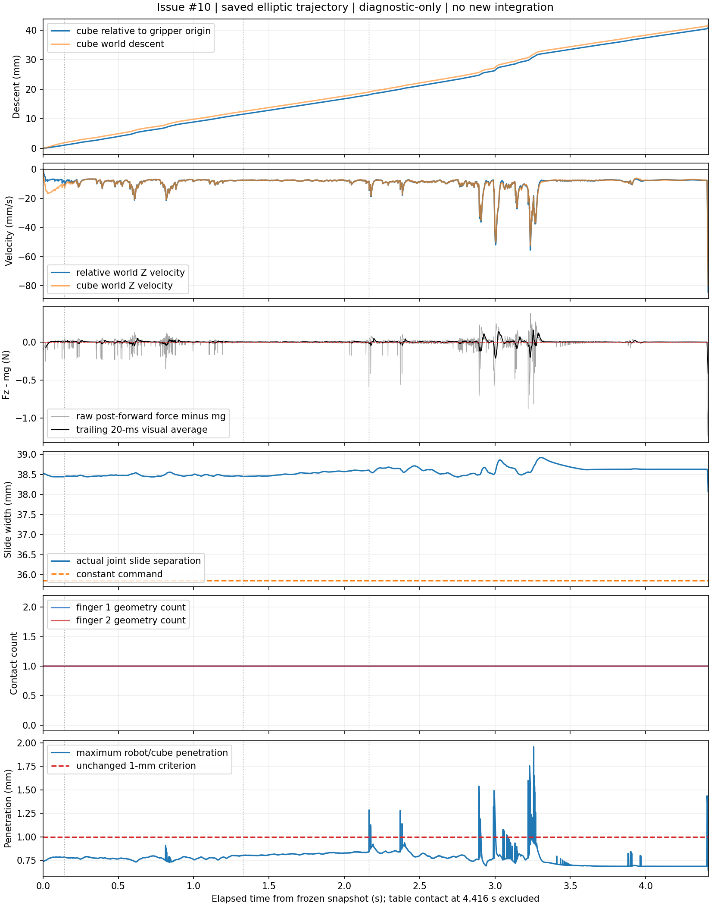
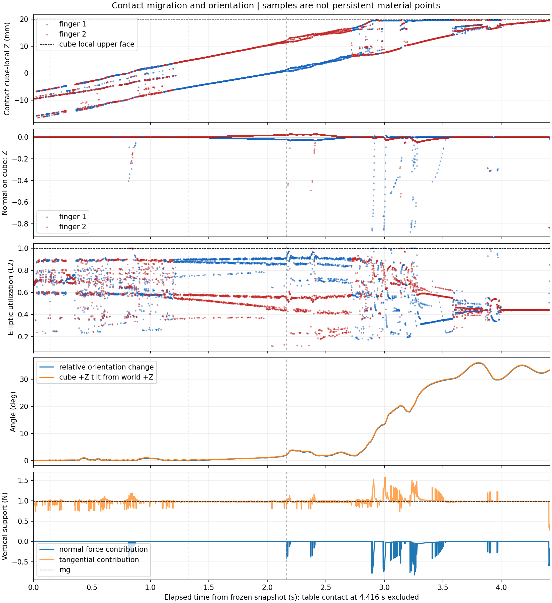

# Issue #10：elliptic 触桌前剩余滑移的只读诊断

日期：2026-10-18。数据均为 **diagnostic-only**；本报告不更新正式抓取成功率，验收待 ChatGPT 独立审查。

**执行/输入核验 PASS；唯一根因 UNKNOWN；没有获得新的物理抓取 PASS。** 原 Run 的 `control_health=FAIL` 原样保留；本轮截取触桌前记录，不能推翻原记录中触桌后的联动超限。 最可能的过程是：初始接近静止的物体在早期形成向下速度；之后接触支持接近重力、部分时段还略高，但没有消除该速度，持续以约 7–9 mm/s 下滑。后期接触样本移向 cube 上缘、物体倾斜明显增大，并出现法向力向下的片段，进一步削减支撑、伴随下滑加速。前半段事实支持 H1，后半段支持 H2 的局部贡献；尚不能证明软接触正则化、几何迁移或转动各自的独立因果份额。

## 冻结输入与本轮边界

- 物理/控制：`1e4d633730f62a398513d33991fa96f9c4977daa`；原诊断：`bf5dc44ab4e97650dfcb0ebdfc550047b87ec947`；elliptic 实验：`c0e23102d7d2231414b712966b9c246615d14f0a`。已阅读 Issue #10、Issue #8、Draft PR #9 及其冻结报告。
- 原始 Run：`/data_robot/projects/.worktrees/nero-gripper-elliptic-ab/experiments/dynamics/runs/diag_cone_elliptic_001/`；Issue #8 的分析与 SHA 清单保留原处。新分支 `feature/elliptic-residual-slip-readonly` 从 c0e2310 派生，独立工作树 `/data_robot/projects/.worktrees/nero-gripper-elliptic-readonly`。
- Ubuntu 22.04 x86_64；主体计算使用原 Python 3.11.9 / MuJoCo 3.2.3 / NumPy 1.26.4 环境。作图复用 `/usr/bin/python3` 3.10.12 / Matplotlib 3.10.7 / NumPy 2.2.6，只读生成图与纯四元数统计，没有安装或修改依赖。
- **新增 `mj_step=0`，不重新生成轨迹，不做力求解，不改模型、控制器、参数、过滤或阈值，不覆盖 Run、不合并 PR。** 仅将保存的 qpos 放入 scratch data，调用 `mj_kinematics→mj_comPos→mj_jac` 还原坐标与点速度。该顺序满足 Jacobian 的最小运动学依赖，[MuJoCo 3.2.3 API](https://mujoco.readthedocs.io/en/3.2.3/APIreference/APIfunctions.html#mj-jac)。
- 校验整个原 Run 及引用资产、旧报告、既有 comparison 与 manifest 的 SHA；trajectory/contacts/model 另有代码固定哈希。新脚本不调用 `mj_forward`、接触力求解或积分 API。共 4416 次运动学评估：初态一次、触桌前保存状态 4415 次；重建位置与原记录最大差 0，接触世界 Fz 与原 qfrc_constraint 平移分量最大差 `2.220446049250313e-16 N`。

## 时间窗与受力、速度

以记录的 snapshot `t0=29.128000000012616 s` 为零点，原始 dt=1 ms。首次 cube/table 接触为 **row4415 / elapsed4.416 s**，不包含在本轮统计和图内。初态 t=0 单列，分析 rows0–4414（0.001–4.415 s）。窗口按保存样本 elapsed 的半开区间划分，避免浮点边界歧义时使用四舍五入后的毫秒 tick。

| 窗口 s | 原始 rows / 样本数 | 末样本相对下降 mm | 平均相对 vz mm/s | 平均(Fz−mg) N | 最大穿透 mm | 最大相对转角 ° |
| --- | --- | ---: | ---: | ---: | ---: | ---: |
| [0,0.141) | 0–139 / 140 | 0.996591 | -7.118546 | -0.007410284 | 0.784644 | 0.119927 |
| [0.141,1.328) | 140–1326 / 1187 | 11.515924 | -8.862117 | +0.000297258 | 0.909437 | 0.893026 |
| [1.328,2.164) | 1327–2162 / 836 | 18.082439 | -7.854684 | -0.000100231 | 0.841048 | 1.940263 |
| [2.164,4.416) | 2163–4414 / 2252 | 40.858462 | -10.113687 | -0.003627096 | 1.958534 | 36.019113 |

相对下降定义为 `初态(cube_COM.z−gripper_base原点.z)−当前间距`，正数表示下滑。相对 vz 是两刚体原点/COM **世界 Z 速度之差**，由 Jacobian 和原始 qvel 计算，未将局部 Z 当作世界 Z。物重 mg=0.981 N。严格按题目列出的时刻取样可复现旧结果：0.141 s 下降1.005371 mm，1.328 s 下降11.523413 mm；它们与上表半开窗口末样本分别相差一个采样步。

初态 cube 世界 vz=`+0.002043 mm/s`、相对 vz=`+0.012796 mm/s`，均接近静止，不存在明显继承的初始向下速度。t=0 保存的 elliptic forward 缓存 Fz=0.842178 N；1 ms 记录的 Fz=0.858740 N，实际 cube vz 已变成−1.386351 mm/s。到0.141 s，世界 vz=−11.107258 mm/s，相对 vz=−8.779462 mm/s。时序与早期支持缺口、随后形成下滑相容，**t=0 缓存和步后力不是积分时力，不能据此严格归因到单个物理步。**

0.141–1.328 s 段平均支持略大于物重，同时观察到实际世界向下速度部分减小，但未到零；1.328 s 时相对 vz 仍为−7.489298 mm/s。1.328–2.164 s 的均力又略低于重力，相对速度继续为负。之后包含多次短时力缺口：4.408 s 的保存 Fz=−0.255898 N，4.415 s 的实际相对 vz=−84.464428 mm/s。不能用整个后段接近重力的均值抹掉这些事件。



图中灰线是原始步后瞬时力；黑色20 ms尾随平均仅用于显示，全部统计使用未平滑记录。控制命令宽度恒为35.848822 mm，实际双滑动关节间距范围38.071265–38.922670 mm；该间距是关节坐标构成的宽度，不是独立测得的网格夹口净空。触桌前双指始终各有一条几何接触；最大耦合误差0.039938 mm，最大臂目标误差0.0027215 rad，未观察到该段丢失双指几何接触或原耦合阈值超限。

## 接触迁移、法向与转动

接触点来自原始日志，坐标转换和接触处相对切向速度由只读运动学重建。它们是“步×接触索引”的样本，**不能将相邻步的接触位置当作同一个材料点的连续轨迹**。

- 首条记录两指接触的 cube-local Z 约−9.42 mm；1.328 s 分别约−5.147 / +4.751 mm；4.415 s 分别约+19.454 / +19.800 mm，接近 cube 的+20 mm上缘。相应力臂随样本位置及姿态改变，完整 XYZ、力矩、局部位置和点速度见 contacts.csv。
- 前140个物理样本，两指法向 Z 分量绝对值≤0.000431，物体最大世界倾角0.258259°；此时相对下降已接近1 mm。因此明显倾斜/不利法向不是初始滑移的必要条件。
- 后段最大物体世界倾角36.190381°、相对转角36.019113°；角速度最高4.397363 rad/s。直接力分解表明存在向下的法向支持分量；并非仅根据总转角猜测。

| 窗口 s | 双指平均法向 Fz N | 双指平均切向 Fz N | 指1/指2总 Fz均值 N | 两指各自 L2利用率中位数 |
| --- | ---: | ---: | --- | --- |
| [0,0.141) | +0.000003420 | 0.973586296 | 0.505513 / 0.468077 | 0.711467 / 0.701937 |
| [0.141,1.328) | -0.003254872 | 0.984552130 | 0.471889 / 0.509408 | 0.668577 / 0.702038 |
| [1.328,2.164) | +0.000148896 | 0.980750873 | 0.761822 / 0.219078 | 0.896725 / 0.555001 |
| [2.164,4.416) | -0.029120953 | 1.006493857 | 0.510880 / 0.466493 | 0.459034 / 0.539727 |

两指分担并非固定对半；中段尤其偏向指1，但总支持仍接近重力。2.164 s 时法向 Fz=−0.410136 N、切向 Fz=+0.804287 N，净支持仅0.394151 N；最大穿透发生在3.257 s，当步法向 Fz=−0.823469 N、切向 Fz=+0.990237 N。4.408 s 两指仍有接触，但法向−0.601600 N、切向+0.345702 N，接触合力已向下。上述是**当步后记录力的几何投影事实**；与随后速度变化关联，不能当作积分冲量或计算其独立因果份额。



elliptic 利用率使用 `rho=sqrt((Ft1/mu1)^2+(Ft2/mu2)^2)/Fn`，实际condim=3、mu1=mu2=1。前140步的280条正Fn接触采样 **全部 rho<1−1e−10**，其中278条重建切向速度>1 mm/s；后续三个窗口分别为2362/2374、1672/1672、4429/4504条位于锥内部，其中2362、1672、4424条仍有>1 mm/s切向运动。1 mm/s只用于描述运动样本，不是新增验收标准，也不是原求解器stick/slip标签。

这说明早期持续滑移并不要求保存合力已达到摩擦边界；与软接触中残余滑移的可能性相容，但尚不能证明正则化就是唯一原因。MuJoCo 的软接触模型不强制硬接触的严格互补性，[3.2.3接触模型说明](https://mujoco.readthedocs.io/en/3.2.3/computation/index.html#physical-realism-and-soft-contacts)。

## H1–H3 判定及 UNKNOWN

| 假设 | 判定 | 支持与边界 |
| --- | --- | --- |
| H1：近重力支持未消除形成的下滑速度，短时净力有缺口 | **支持** | 初态近静止，早期形成负速度；中段略正均净力后仍为负速度。不能称为“继承了初始向下速度”，也不能从瞬时力推导精确积分冲量。 |
| H2：接触迁移/法向倾斜/转动降低有效支持 | **支持后期局部分量；全段独立因果 UNKNOWN** | 位置移向上缘、转动和不利法向片段被直接记录；法向负Fz可精确投影。早期已滑移而倾角/法向倾斜很小，故不是足够的全段解释；转动、穿透、位置迁移与力变化相互耦合。 |
| H3：>1 mm 穿透是后期因素，不是初始滑移必要条件 | **支持“非初始必要条件”；放大因果 UNKNOWN** | 首次>1 mm发生在2.164 s，早在68 ms及141 ms已滑移，触桌前最大1.958534 mm。超限与后期接触跳变、失稳关联，未做单变量干预，不能证明穿透独立放大了滑移。 |

没有保存积分期间接触力/冲量、每步原始 efc_state/正则化数组或材料点身份。本轮不补求解这些量。仅以整段步后力做右端矩形近似，预测世界Δvz=−0.0893661 m/s；实测为−0.0799264 m/s，残差−0.00943965 m/s。左端移位/梯形近似及各段误差另存JSON，**不是精确动量闭合，不用于定量分摊因果**。几何接触仍在、rho<1、均力≈mg均不能单独证明稳定抓持。

额外差分核对曾错误要求“相邻位移差分/1 ms”与“步末Jacobian速度”在2e−8 m/s内相等，因100/4415条超出该临时容差而退出1。它们分别是步间平均速度和步末瞬时速度，不应强求严格等值；实测最大差7.65343e−8 m/s已保留为描述性误差，没有修改源数据、物理阈值或以放宽Gate宣称精确一致。位置下降量的独立重算逐元素完全一致。

## 至多一个后续候选：只建议，未执行

**唯一候选：下一轮若另获批准，在独立派生诊断模型只将 elliptic 的 `impratio: 1→10`。** 保持同一完整pre-forward初态/控制器、cone=elliptic、几何、mu、质量、增益、桌面、dt、solver和判据；不得同步改其它项。forward后缓存应重新记录，不能强求相等。

依据：早期多数切向运动发生在保存合力的椭圆锥内部，尚未触及几何摩擦上限；该设置可用于检验摩擦约束阻抗是否对残余滑移敏感。官方文档说明该参数调节 elliptic 的摩擦/法向阻抗比，较大值通常减少滑移而不提高摩擦系数，[MuJoCo 3.2.3 impratio](https://mujoco.readthedocs.io/en/3.2.3/XMLreference.html#option-impratio)。这只是敏感性候选，**不是已确认的根因或物理标定建议**。

候选的主要可证伪预言：elapsed1.328 s 相对下降 **<5.761707 mm**（本elliptic基线11.523413 mm的一半；仅诊断预言，不是修改抓取标准）。辅助观察原窗口的逐指切向点速度、rho、Fn/Fz分解、穿透、姿态与原控制健康判据；需要排除仅因其它失败增大而得到表面改善。若未满足该预言，就不支持这项预言，不继续自动扫描其它数值。本轮没有创建该变体或执行任何干预；是否进行下一实验或停止诊断、转向最小抓取基线，由 ChatGPT 审查后决定。

## 复核与交付

在本工作树运行，主体分析用完整解释器路径：

```bash
/data_robot/projects/.worktrees/nero-gripper-grasp-diagnosis/.venv/bin/python experiments/dynamics/readonly_slip/analyze.py --source /data_robot/projects/.worktrees/nero-gripper-elliptic-ab/experiments/dynamics/runs/diag_cone_elliptic_001 --output-dir debug/issue10/analysis_001
python3 experiments/dynamics/readonly_slip/plot.py --analysis debug/issue10/analysis_001 --output-dir experiments/dynamics/readonly_slip/figures
/data_robot/projects/.worktrees/nero-gripper-grasp-diagnosis/.venv/bin/python -m unittest discover -s experiments/dynamics/readonly_slip -p test_analysis.py -v
```

实际均退出0；主体分析wall time19.402 s。4项针对坐标转换、力符号/力矩、L2和时间窗边界的纯数学检查通过；既有保存记录加载器对完整14100行完成校验。没有重跑全量仿真测试，没有增加CI/Gate。分析/图目录拒绝覆盖；复算必须指定新的输出目录。原始Run、旧报告及受保护分支/工作区状态均在结束时再次核对。

本目录提交脚本、报告、生成的 `summary.json`、两幅图及 `plot-and-supplement.json`，便于远端审查。完整逐步派生数据仅留本地：`debug/issue10/analysis_001/{series.npz,contacts.csv,summary.json}`；Issue/PR快照、命令与退出码、输入与产物SHA清单、边界核验留在 `debug/issue10/`。报告中的数值可从 summary 的明确rows和contacts.csv重算，不依赖额外仿真。

关键原始SHA256：

- model.xml：`79f5f9116e812687e9c4592f9faf42e9660276f77329297e690be4a0db28d376`
- trajectory.npz：`fea51467c8001321dddea0f16eb85bf60f9184f2fdb2d507fd9a1464dfad948d`
- contacts.jsonl：`89aeb60697d7c6badde163965439b2b2fe37bffc02845b1a41d36a33ec5d43b5`

本轮结论是“已有记录可解释的机制被缩小”，不是修复完成；独立 Draft PR 仅供只读诊断审查，不合并 main 或 PR #3/#9。
