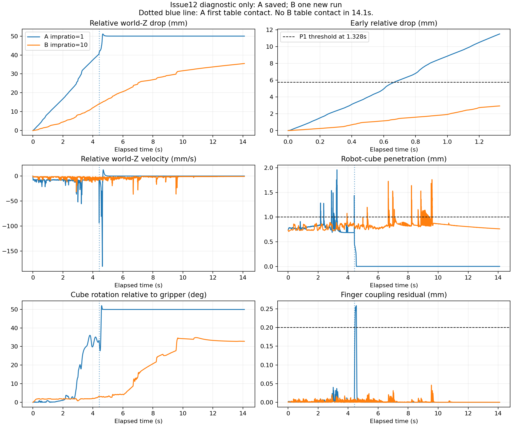

# Issue #12：elliptic impratio 1→10 单次冻结承载对照

2026-10-18，Ubuntu 实际执行，全部结果为 **diagnostic-only**，等待 ChatGPT 独立审查。

**P1 PASS；原 Recorder：A FAIL、B PASS；原穿透判据：两组 FAIL；正式 lift/hold 任务 UNKNOWN（本诊断未执行）。** B 的早期滑移明显减小，14.1s 内持续有双指接触、没有触桌，但仍累计相对下降35.491235mm，末态相对速度−0.824375mm/s。不能称为稳定抓持、正式模型修复或实机标定通过。

## 冻结输入与唯一差异

- 已阅读 [Issue #12](https://github.com/LeoandDream/Nero_Gripper_assets/issues/12)、关联 #8/#10、Draft PR #9/#11、两轮报告及 PR #11 最新审查。没有使用或修改官方 MJCF 路线。
- 物理/控制冻结 `1e4d633730f62a398513d33991fa96f9c4977daa`，诊断 `bf5dc44ab4e97650dfcb0ebdfc550047b87ec947`；新工作树 `/data_robot/projects/.worktrees/nero-gripper-impratio-ab`，分支 `feature/elliptic-impratio-ab`，严格从 `c0e23102d7d2231414b712966b9c246615d14f0a` 派生。
- A 原始目录 `/data_robot/projects/.worktrees/nero-gripper-elliptic-ab/experiments/dynamics/runs/diag_cone_elliptic_001/`：直接复用全部保存数据，**新增积分0步**。核对整个原 Run 的 Issue8 manifest、准备输入及86份实际引用资产 SHA；正式资产153项 SHA256SUMS保持一致。
- B 新目录 `/data_robot/projects/.worktrees/nero-gripper-impratio-ab/experiments/dynamics/runs/diag_impratio10_001/`：**唯一一次14,100个真实 mj_step**，模拟14.1s，进程退出0，wall18.156859s，没有重放前缀、扫描、重试或额外动力学实验。
- Ubuntu22.04 / Python3.11.9 / MuJoCo3.2.3 / NumPy1.26.4，复用现有虚拟环境；作图单独使用已有 `/usr/bin/python3` / Matplotlib，不安装或修改依赖。

完整有效 XML diff 仅为：

```diff
-  <option timestep="0.001" integrator="implicitfast" gravity="0 0 -9.81" cone="elliptic" />
+  <option timestep="0.001" integrator="implicitfast" gravity="0 0 -9.81" cone="elliptic" impratio="10" />
```

编译确认459个公开模型数组/标量字段一致，全部其它 option 一致，仅 `opt.impratio=1→10`。cone=elliptic、Newton、implicitfast、dt=.001s、质量.1kg、摩擦/condim、几何、solref/solimp、equality、过滤、执行器及控制/验收参数均保持原值。正式 MJCF、原 Run 和既有分支未改。

## 预注册、完整初态与时序

运行前提交 **`d00750a7e3848e5d0f94e53b7a6eb7ff7590d662`** 保存 runner、4项零积分检查和 [完整预注册记录](issue12-preregistration.json)。预测/准备记录先于物理运行封存，UTC13:11:09确认尚无STARTED；唯一运行于UTC13:11:52开始。

| 项目 | SHA256 |
| --- | --- |
| prediction.json | `6520cc3ddc2942588436c14ae92ccd8e14903cae4161fef04291f446bf6c82f8` |
| prepared.json | `ccc26ea1ee62a995d257909633180df1d23ef5c2c3bb965b26badde787f2f212` |
| 当次 runner 源 | `994d75bb6e9a2ed506200e5fa4666493e12b5896b83f1490c973844ec2f03c1e` |
| 共同156D pre-forward原始float64状态 | `38fed316c9733655dcf6f6db655204f69e21d0d4f84db3916808eb1a83cb5d10` |
| 共同8D requested/command | `ac9809da982cc3ce9385b193a989750f745b42426bbd4284679ab6d85ee66f5b` |

恢复完整 `mjSTATE_INTEGRATION`，t0=29.128000000012616s，包含时间、qpos/qvel、warmstart、ctrl、外力和eq_active；不使用已经forward过的状态冒充共同初态。双方保存恢复前/后pre-forward向量，逐元素一致。双方post-forward缓存另存NPZ：约束维数均7；qacc/warmstart最大分量差39.178576887，qfrc_constraint差0.052661173，efc_force差0.033254237；efc_R/D不同，qfrc_bias/efc_state等相同。**缓存差异是本配置干预的合法结果。**

复用冻结 `Controller.apply→mj_step→mj_forward→Recorder.record`，所有14,100步 time、phase、requested、command、physical_target与A完全相同。反馈ctrl允许自然分岔，没有回放旧力指令。积分期间无qpos写入、重置、附着、外力或新增支撑。STARTED排他创建，已有Run拒绝覆盖。

## P1 与关键结果

预言使用 Issue 的字面阈值：elapsed=1.328s，B的相对世界Z下降 **严格<5.761707mm**，且snapshot至该时刻没有cube/table几何接触。下降为初始 `(cube_COM.z−gripper_base原点.z)` 减当前间距；不是夹爪局部Z。post-step row0=1ms，1.328s对应row1327。

**实际A=11.523413089mm，B=2.934305127mm，减少8.589107962mm（74.5361%），P1 PASS。** 两组在该时刻前都无桌面接触；B整段14.1s也无桌面接触，因此改善不能归于桌面承载。P1是预设效应门槛，不是理论必然或抓持成功标准。

| elapsed | A下降mm | B下降mm | A世界vz mm/s | B世界vz mm/s |
| --- | ---: | ---: | ---: | ---: |
| .068s | .447044 | .075315 | −14.626927 | −8.783696 |
| .141s | 1.005371 | .166879 | −11.107258 | −3.486335 |
| .751s | 6.404821 | 1.515532 | −7.588948 | −1.297253 |
| 1.328s | 11.523413 | 2.934305 | −7.490705 | −1.198758 |
| 2.164s（双方仍无桌支撑） | 18.090755 | 5.009585 | −8.328696 | −2.121342 |
| 14.1s（A已触桌，仅作末态说明） | 50.000382 | 35.491235 | ≈0 | −.820759 |

| 事件/指标 | A impratio1（保存对照） | B impratio10（单次新Run） |
| --- | ---: | ---: |
| 首次相对下降≥1mm | .141s | .494s |
| 首次cube/table几何接触/向上支持力 | 4.416s | 14.1s内未出现 |
| 首次任一指几何接触不足 | 4.419s | 14.1s内未出现 |
| 首次任一指Fn<原阈值.05N | 4.419s | 14.1s内未出现 |
| 首次穿透>原阈值1mm | 2.164s | 3.929s |
| 最大robot/cube穿透 | 1.958534mm | **1.759891mm，FAIL** |
| 首次联动残差>原阈值.2mm | 4.458s（触桌后） | 未出现 |
| 最大联动残差 | .258720mm | .045928mm |
| 最大臂目标误差 | .002721497rad | .002739541rad |
| 原Recorder control_health | FAIL | PASS |

公平的共同无桌窗口为post-step rows`[0,4415)`，0.001–4.415s，严格排除A首次触桌row4415；snapshot单列，不参与均值。窗口末下降A40.858462mm、B14.118800mm；平均相对vz分别−9.254466/−3.197918mm/s。双指平均Fz为A(.547744+.431232)=.978976N、B(.820565+.160345)=.980910N，物重.981N。双方均存在近重力平均支持下的持续下滑；不能把均力接近物重解释为止滑。

各自无桌窗口长度不同：A4415步、B14100步；各自摩擦利用率/切向速度统计保存在JSON，**不能把不同窗口的均值当作同长效应量**。椭圆锥使用逐正Fn接触的L2利用率，接触点切向速度仅以保存qpos/qvel和scratch `mj_kinematics→mj_comPos→mj_jac`重建；没有补做力求解。每步法向/切向Fz、rho、位置/转动/点速度/力矩、穿透、联动、跟踪、限幅与警告均有原始或派生记录。接触坐标是“步×接触索引”采样，不是材料点连续轨迹；rho不等于原求解器stick/slip标签。



图中A触桌后的静止仅作背景显示，不用于共同无桌性能统计。B后期仍有明显接触跳变、转动和下滑；P1通过没有消除这些现象。

## 原判据与因果边界

B原Recorder的PASS只对应其耦合/关节速度检查（最大臂速度.025614568rad/s、指速度.007572251m/s），该Recorder没有正式phase验收。原始warning全0、状态有限、外力全0、执行器无超限或饱和。A的原control_health=FAIL原样保留。

**B已知的原robot/object穿透项目FAIL，不可宣布完整原判据PASS。** 正式抓取标准仍为抬升≥.08m、hold2s/漂移≤.01m、双指比例≥.95且Fn≥.05N、穿透≤.001m，以及原控制健康要求。此固定承载诊断没有执行完整lift/hold序列，完整正式任务标记UNKNOWN_NOT_EVALUATED，不生成成功率；不能用14.1s累计漂移直接替代原2s hold窗口。观察上B无桌双指承载持续至观察终点，但仍在滑移，没有建立稳定抓持成功。

结果支持“这个冻结初态对全局impratio敏感”，与[MuJoCo3.2.3参数说明](https://mujoco.readthedocs.io/en/3.2.3/XMLreference.html#option-impratio)相容。它不是摩擦系数变化，不证明唯一根因、各因素独立因果份额、现实动力学准确性或总体统计显著性。接触、转动、软约束和控制反馈会共同演化。保存力为 **post-step forward瞬时值，不是积分时冲量**。本轮不继续任何参数值、重试或修复，由后续审查决定是否终止诊断线。

## 复现、证据与审查

工作目录为新工作树；以下实际命令的 `python` 均指 `/data_robot/projects/.worktrees/nero-gripper-grasp-diagnosis/.venv/bin/python`。

```bash
python experiments/dynamics/grasp_impratio_ab.py prepare --source-dir /data_robot/projects/.worktrees/nero-gripper-elliptic-ab/experiments/dynamics/runs/diag_cone_elliptic_001 --output-dir experiments/dynamics/runs/diag_impratio10_001
# 下条已执行且不可重跑；STARTED/原始输出必须保留。
python experiments/dynamics/grasp_impratio_ab.py run --output-dir experiments/dynamics/runs/diag_impratio10_001
python experiments/dynamics/diagnose_impratio_ab.py --a-dir /data_robot/projects/.worktrees/nero-gripper-elliptic-ab/experiments/dynamics/runs/diag_cone_elliptic_001 --b-dir experiments/dynamics/runs/diag_impratio10_001 --output-dir debug/issue12/analysis_001
python experiments/dynamics/verify_impratio_ab.py --source /data_robot/projects/.worktrees/nero-gripper-elliptic-ab/experiments/dynamics/runs/diag_cone_elliptic_001 --run experiments/dynamics/runs/diag_impratio10_001 --output debug/issue12/verification.json
python -m unittest discover -s experiments/dynamics -p test_grasp_impratio_ab.py -v
/usr/bin/python3 experiments/dynamics/plot_impratio_ab.py --analysis debug/issue12/analysis_001 --output reports/issue12-impratio-ab.png
```

准备、单次积分、只读分析、核验、作图均退出0；4项针对唯一差异/非法差异/拒绝覆写的检查通过，测试积分0步。开发初次检查因runner尚未实现而预期退出1，保留tests-red.log；准备及物理执行无失败/重试。分析与核验新增积分和力求解均0；运动学/保存姿态最大差0，接触投影与cube竖直广义力最大误差A4.44e−16N/B2.22e−16N。没有运行会增加物理实验的全量测试，没有新增CI或强制Gate。

- [机器可读完整对照摘要](issue12-comparison.json)：全部关键采样/事件、逐组原健康输出、窗口统计及输入SHA。
- [证据清单](issue12-evidence-manifest.json)：A/B完整绝对路径、逐文件SHA/字节数、预注册时间/提交、实际命令/退出码/耗时、零积分核验结果及受保护工作树状态。
- B原始Run保留model/diff、snapshot、双方缓存/初始接触、prepared/prediction/protocol、当次runner、trajectory、contacts、contact-parameters、observations、warnings、execution和result；A所有原文件原样保留。
- 本地 `debug/issue12/analysis_001/` 保存A/B逐步派生NPZ（含snapshot）及完整contacts.csv；`debug/issue12/` 保存Issue/PR快照、freeze.json、命令日志、检查及审查记录。大日志不提交正式资产目录。

运行前和运行后独立只读Reviewer未发现Critical/Important阻断；独立NumPy/JSON重算P1、关键事件、穿透和末态，确认只有B一次积分，A/原资产未变。它不构成合并或正式验收批准。仅创建新的诊断Draft PR，PR #3/#9/#11保持原样，不合并main；Git身份使用LeoandDream。
