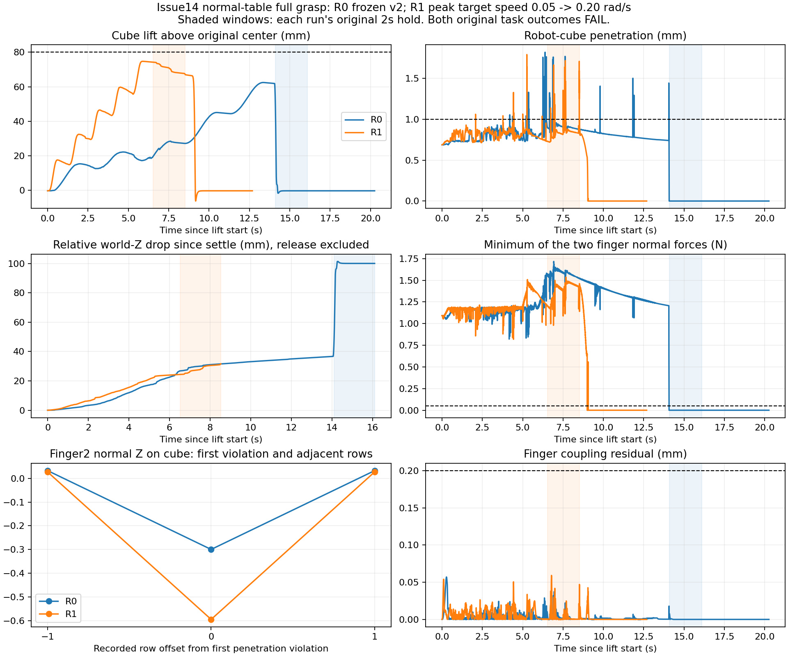

# Issue #14：正常桌面、有边界的完整抓取闭环

2026-10-18，Ubuntu 实际执行；全部模型/动作结果均为 **diagnostic-only**，交 ChatGPT 独立验收。

**闭环已执行并保留证据；完整 fixed 抓取仍 FAIL，唯一物理根因 UNKNOWN。** Gate0通过；R0真实运行完整原v2流程；定位最早穿透违规后，预注册并执行一次独立单变量提速R1，再按全部原判据评测。提速改善了抬升和保持期承载，但没有通过穿透、80mm抬升和10mm漂移要求。停止物理迭代：**2个Episode、83,598个真实mj_step**，没有为了用完预算追加动作或偏移任务。

## 版本、场景和 Gate0

已阅读 Issue #14、#2/#8/#10/#12 及关联报告，包含PR #13的最新ChatGPT审查。#12低桌面悬空承载的P1成功不代表本任务成功，本轮没有使用其model.xml、snapshot或14.1s轨迹。

- 新工作树 `/data_robot/projects/.worktrees/nero-gripper-full-grasp`，分支 `feature/bounded-full-grasp`，从 `a1d899c40626962bd62fc0d02d9ec779a3513cb6` 派生。
- 物理/控制/原评测冻结为 `1e4d633730f62a398513d33991fa96f9c4977daa`。`run.py/controller.py/config.json/grasp.json/base-filter-approval.json`逐字节核对；153项正式资产SHA与86项实际引用资产均通过。原base/link1单对过滤保留，没有其它过滤。
- **正常桌面**中心[-.32,0,.065]、半尺寸[.12,.12,.065]，顶面.13m；fixed方块中心[-.32,0,.15]、半尺寸[.02,.02,.02]、质量.1kg。原两偏移±[.003,.003]m、yaw±2°均预先规划，未进入物理执行。
- 原builder先生成本任务default XML，再仅给派生XML增加 `cone="elliptic" impratio="10"`。459个公开编译字段一致，所有其它option一致。**相对最早full-grasp有两个已批准solver差异，不称为与最早baseline的单变量物理A/B。** R0与R1的最终model.xml字节完全相同。
- 三个case的完整cube/IK/waypoint计划与Issue2原 `diag_baseline_001/frozen-protocol.json`逐项完全相同，目标数值最大差0。每case复用原规划的限位/开放夹口非目标碰撞筛查，并保存合法时间0初态和起始接触。该scratch筛查不等于加载后实际路径已安全。
- Ubuntu22.04 / Python3.11.9 / MuJoCo3.2.3 / NumPy1.26.4。复用现有环境，无安装、硬件、官方MJCF、训练或采集。

初版零积分准备`issue14_full_grasp_001`保留原处；运行前Reviewer发现新wrapper对登记case缺少封存计划绑定，修正后在独立`issue14_full_grasp_002`重新完成Gate0。两次准备均0步、0个物理Episode，没有覆盖旧准备或历史Run。

正式准备SHA：`f8a51d8e7d82f810b671733f4bf852c60e3a3b191befca5bc18db88ca0026ba0`。积分前提交 **`ea29b248b0722e3bd5673ea8ca522a28b6d79ed2`** 保存wrapper、针对性检查和[预注册/完整冻结计划](issue14-preregistration.json)。R0登记SHA `d9c9cdd7d662beddb10182843ee4e29a64ae1b70f65d7df2f43e582ebfab40cf`。

R0/R1各自合法reset到同一个原始初态，156D integration state原始float64 SHA均为 `6e6d4e9265fb2a44fd95b0c4c5a2c28f7ac83946ac61d7abb5e7cd60bcdeb1d9`。不在执行中改状态、附着、施力、加支撑或重置。每次独立STARTED/目录，保守预约计数，拒绝覆盖和恢复。

## Gate1 / Gate2：实际结果

复用原 `execute_grasp`、Controller、Recorder和 `evaluate_grasp`。wrapper仅派生场景、延伸只读记录及输入核验；时序仍为 `Controller.apply → mj_step → mj_forward → record`。两次均完整执行open、5段approach、close、grasp_settle、5段lift、连续2s hold、release；原runner没有因阶段FAIL而新增提前停止。

| 指标 | R0：冻结v2 | R1：独立提速候选 |
| --- | ---: | ---: |
| 唯一动作差异 | 无，原peak=.05rad/s | peak=.20rad/s，其余R0 |
| 实际物理步/模拟时长 | 49,374 /49.374s | 34,224 /34.224s |
| 真实进程退出码/wall | 1 /63.2631s | 1 /44.6210s |
| 原最终任务 | **FAIL** | **FAIL** |
| 原控制健康/全部控制phase | PASS | PASS |
| 最大方块抬升 | 62.485845mm | 74.763615mm |
| hold最小抬升，原要求≥80mm | −1.562601mm，FAIL | 67.063692mm，FAIL |
| hold时长 | 2.000s，PASS | 2.000s，PASS |
| hold世界欧氏漂移，原要求≤10mm | 58.407452mm，FAIL | 13.969526mm，FAIL |
| hold双指Fn≥.05N比例，原要求≥.95 | 0，FAIL | 1.0，PASS |
| hold原非指支撑样本 | 1945/2000，FAIL | 0/2000，PASS |
| 最大robot/cube穿透，原要求≤1mm | 1.820234mm，FAIL | 1.791856mm，FAIL |
| lift阶段时长 | 14.100s | 6.525s |
| 实际释放诊断 | UNKNOWN：此前已掉落；开启动作完成 | PASS：双指承载后开启、分离、下落 |

退出1为**原抓取判据失败**，不是程序异常；两次error均null，数值警告/外力/执行器超限和饱和均0。控制phase的PASS仍按原阶段末250ms及loaded-finger豁免语义，不把运动瞬态误差改为新标准。保持漂移是原世界欧氏距离，不是相对夹爪Z下降。

| 阶段的原记录/适用条件 | R0 | R1 |
| --- | --- | --- |
| open、approach、close、grasp_settle | PASS | PASS |
| lift：原穿透项目已违规 | FAIL | FAIL |
| hold：原完整窗口条件 | FAIL | FAIL |
| release：原开启控制phase | PASS | PASS |

原evaluate_grasp没有释放成功项；因此另列“物理释放诊断”，不改写原结果。R1在hold末虽然不足80mm，仍有双指承载、无非指支撑、箱体最低点高于桌面57.230mm；随后真实开启、失接触并下落，支持实际释放发生，**不证明稳定抓持或正式任务通过**。R0hold末已由桌面承重，不能把空夹爪开启包装成抓住后释放。

## 最早失效、动作假设及反证

**R0最早原硬阈值违规**：t=33.319s、row33318、物理step33319，lift阶段指2/cube穿透1.054967mm。此前已真实离桌；不能沿用旧baseline“完全没抬起来”的结论。

R0的settle结束于29.118s，穿透约.687mm，尚合格。首次硬违规时夹爪已上升33.906mm、方块只上升20.917mm，相对世界Z间距下降12.988mm；1mm相对滑移描述标记先在29.971s出现。双指Fn约[1.173,.852]N，但对cube世界Fz分别[+.993942,−.225510]N，桌面0；Fn不能当作竖直支持。指2接触在cube-local Z约+19.437mm，接近20mm上缘。

据此唯一R1候选仅将 `expert_peak_joint_target_speed_rad_s:.05→.20`，控制器原slew=.20、kp/kv、路径、每waypoint原.8s停留、压缩1.5N位置等效目标和全部物理/判据不变。该标量影响整个专家运动的时序，不能声称只隔离了lift或纯暴露时间；它也改变动态载荷。没有叠加其它调整或再试其它速度。

**事前H1**：在同一参考进度——第二个lift waypoint结束时——相对settle末世界Z下降严格<10mm，且截至该点原最大穿透≤1mm。完整任务另按全部原标准评估，不以H1代替。预注册提交`3fc9531`，R1登记SHA `efade1260109d3fe8d236963dacbabc3f18b2a372c3d7e7a980abd2e6c689f0d`，见[封存假设](issue14-R1-prediction.json)。其中R0参考值曾有一处精度引用错误，运行前提交`7dcda1c`按原NPZ更正为20.712474293mm；原登记保留，动作和10mm/1mm预言从未更改。

| 第二lift waypoint结束的事前指标 | R0参考 | R1实测 | R1判定 |
| --- | ---: | ---: | --- |
| 相对settle末下降 | 20.712474mm | 9.015513mm | <10mm，PASS |
| 截止该点最大穿透 | 1.330662mm | 1.061109mm | >1mm，FAIL |
| H1两项同时成立 | — | 未成立 | **FAIL** |

R1最早原硬违规为t23.624s、row23623/step23624、lift已执行2.081s，仍为指2/cube穿透。当时相对下降6.483mm，指2接触cube-local Z约 **+.139mm，处于侧面中部**，不能用“首次违规必然因为滑至上缘”解释两次运行。它是三条相邻记录中的接触特征切换：

| R1原始row | 穿透mm | 对cube法线世界Z |
| ---: | ---: | ---: |
| 23622 | .731115 | +.026813 |
| **23623** | **1.061109** | **−.594889** |
| 23624 | .732999 | +.027047 |

该1ms物体姿态变化约.00383°，但保存接触法线明显跳变；这是solver接触样本事实，非材料点轨迹或已证明的仿真器bug。全R1有93条>1mm记录，后续最大穿透1.791856mm；**不删除单帧、不平滑阈值、不放宽1mm，让H1或任务通过。** 力均为post-step forward瞬时值，不是积分时冲量。

## 停止条件与下一项唯一建议

R1证明时序可以改善相同参考进度的累计滑移和最终承载，但H1及完整任务仍失败。初始夹持穿透原本合格，简单降压缩可能增滑，目前无法从R0形成更有证据的第二独立动作变量假设；不继续速度/夹紧量扫描，不叠加动作，不改模型。**R2未运行；两项偏移因fixed没有全部PASS而未运行**，剩余预算保留。

唯一建议：下一轮先对已保存R1 rows23622/23623/23624的指2接触点/法线切换做离线几何核对，区分碰撞代理特征、真实局部几何和接触求解影响，再决定是否另行授权修正。当前独立因果份额UNKNOWN，不宣称动作层无解，也不将诊断参数写入正式MJCF；不进入示教采集或训练。

## 自动检查、命令与证据

5项wrapper检查和10项纯保存数据fixture检查通过，全部新增积分0步；覆盖唯一差异、case/初态绑定、原评测重算、异常末步、部分阶段和释放真实性。实际保存记录核验PASS：原AST评测逐字段一致；三条件封存、R0/R1模型相同、只有一个动作标量差异、完整初态相同、time/记录对齐、控制限幅/零外力/告警和原标准一致。未运行会增加物理Episode的全量仿真测试，未新增CI/强制Gate。

工作目录为上述新工作树，`python`为 `/data_robot/projects/.worktrees/nero-gripper-grasp-diagnosis/.venv/bin/python`。关键实际命令：

```bash
python experiments/dynamics/full_grasp_loop.py prepare --campaign experiments/dynamics/runs/issue14_full_grasp_002
python experiments/dynamics/full_grasp_loop.py register --campaign experiments/dynamics/runs/issue14_full_grasp_002 --label R0 --strategy R0 --hypothesis-file debug/issue14/R0-hypothesis.json
python experiments/dynamics/full_grasp_loop.py run --campaign experiments/dynamics/runs/issue14_full_grasp_002 --label R0
python experiments/dynamics/full_grasp_loop.py register --campaign experiments/dynamics/runs/issue14_full_grasp_002 --label R1 --strategy R1 --hypothesis-file debug/issue14/R1-hypothesis.json
python experiments/dynamics/full_grasp_loop.py run --campaign experiments/dynamics/runs/issue14_full_grasp_002 --label R1
python experiments/dynamics/diagnose_full_grasp.py --episode experiments/dynamics/runs/issue14_full_grasp_002/R0 --output-dir debug/issue14/R0-analysis-final
python experiments/dynamics/diagnose_full_grasp.py --episode experiments/dynamics/runs/issue14_full_grasp_002/R1 --output-dir debug/issue14/R1-analysis-final
python experiments/dynamics/verify_full_grasp.py --campaign experiments/dynamics/runs/issue14_full_grasp_002 --analyses debug/issue14 --output debug/issue14/verification.json
python -m unittest discover -s experiments/dynamics -p test_full_grasp_loop.py -v
python -m unittest discover -s experiments/dynamics -p test_diagnose_full_grasp.py -v
/usr/bin/python3 experiments/dynamics/plot_full_grasp.py --campaign experiments/dynamics/runs/issue14_full_grasp_002 --analyses debug/issue14 --output reports/issue14-full-grasp.png
```

两条物理run命令实际退出1，其余最终命令退出0。旧准备、最初实现不存在的预期失败检查、初版只读分析和审查修正记录均保留；物理执行无程序异常、重试或覆盖。分析器修正只影响诊断标签/异常证据，原evaluate_grasp及其结果不变。只读分析/核验0积分、0力求解；作图单用已有系统Python/Matplotlib，不导入MuJoCo。



图按lift开始对齐；阴影是各自原2s hold。相同elapsed不等于相同参考进度，H1严格使用第二waypoint末点，不能用图上任意时刻替换。

- 原始Run：`/data_robot/projects/.worktrees/nero-gripper-full-grasp/experiments/dynamics/runs/issue14_full_grasp_002/{R0,R1}/`。各自含原model/default/diff、protocol、initial-state、STARTED、当次源码/登记、每步trajectory/contacts/contact-parameters/observations/warnings、原result/grasp-result、execution和raw-manifest。
- 本地 `debug/issue14/{R0,R1}-analysis-final/`：逐阶段、逐waypoint、原验收、事件表和首失效完整状态/接触；`debug/issue14/`：真实命令/退出码/耗时、Issue快照、假设、补充接触几何和审查记录。大日志留Ubuntu本地。
- [完整机器结果](issue14-results.json)：两个原验收、阶段/事件、H1对照、首失效几何与停止理由。
- [证据及SHA清单](issue14-evidence-manifest.json)：所有原始文件路径/大小/SHA、冻结输入、实际命令、检查和受保护工作树状态。

| 原始轨迹 | SHA256 |
| --- | --- |
| R0 trajectory.npz | `ae210b35827b2e9bc12d5496c9548da5b50f0762fb37d5b90bee3f5590b430e9` |
| R1 trajectory.npz | `aa90f76b401d8f6ad5b24db7f0dea8c7eefaf9b397c7cc0eee50ac3dea957651` |
| 共同实际model.xml | `05b364b0696e0afa90bc39a07bcc46e655933ba14037fc5e1cf26108e6249492` |

独立Reviewer分别核对冻结输入、wrapper修正、R0/R1首事件、H1和原判据。只创建新的诊断Draft PR，目标为`feature/elliptic-impratio-ab`；原main与既有Draft PR不改、不合并。执行和证据交付完成不等于抓取通过，最终验收留待ChatGPT。
