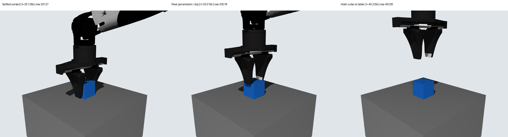

# Issue #2：冻结抓取失败诊断

## 1. 固定版本与环境 — PASS

Ubuntu 22.04 x86_64，Python 3.11.9，MuJoCo 3.2.3，NumPy 1.26.4，SciPy 1.15.3。
独立 worktree：`/data_robot/projects/.worktrees/nero-gripper-grasp-diagnosis`；仿真运行时 HEAD 为 `1e4d633730f62a398513d33991fa96f9c4977daa`。
原 153 项 SHA 与四份实际执行源码均核验一致。仅新增诊断脚本、测试及本次证据说明；未改原模型、物体、增益、摩擦/接触/equality、过滤或成功标准，未访问机器人硬件。`main`、`feature/delivery-convergence` 均未改。

## 2. 实际命令与状态

| 执行 | 实际结果 |
|---|---|
| `.venv/bin/python scripts/test.py`（新增诊断器前） | PASS，静态9+动态12，含真实37,000步空载控制测试 |
| `.venv/bin/python experiments/dynamics/run.py --stage grasp --filtered --run-id diag_baseline_001` | FAIL，退出1；49,387个真实 `mj_step`，无程序异常；仅fixed进入物理执行 |
| `.venv/bin/python scripts/test.py`（诊断器审查修正后） | PASS，退出0，静态9+动态20，共29项；其中新增诊断器8项 |
| `.venv/bin/python experiments/dynamics/diagnose.py --episode-dir experiments/dynamics/runs/diag_baseline_001/fixed --output-dir debug/issue2/analysis-final` | PASS，退出0，49,387行NPZ/JSONL对齐；输出JSON与阶段CSV，现存目录拒绝覆盖 |
| `.venv/bin/python debug/issue2/hold_only_probe.py` | PASS（仅诊断执行），`diag_hold_only_002`，43,228步；未评估正式抓取成功 |
| 离线FK/三关键帧 | PASS，读取已保存状态，零 `mj_step`；`grasp_center`仅为非物理规划site |

首轮辅助保持对照 `diag_hold_only_001` 因逐行重复解压NPZ过慢，由操作者中断于454步，退出130；原记录及源码保留，不计为完成对照。缓存相同数组后重跑为002，不改变任何物理/控制/判据。仅一组控制变量条件，无参数扫描。完整命令、依赖和真实退出码见下列证据目录。

## 3. 阶段性接触证据

行号均从0开始，JSONL行号为行号+1。接触力为每步后 `mj_forward` 重算的瞬时值，不是积分平均力。

| 阶段 | 首/末采样时刻s | 双指均≥0.05N比例 | 桌面接触比例 | 核查结果 |
|---|---|---:|---:|---|
| open | 0.001–1.847 | 0 | 100% | 无手指/物体接触 |
| approach | 1.848–15.947 | 0 | 100% | 无手指/物体接触 |
| close | 15.948–28.128 | 1.16% | 100% | 27.952s开始接触；末行双侧达到0.2N触发 |
| grasp_settle | 28.129–29.128 | 100% | 100% | Fn末值1.059/1.071N，桌面仍承重 |
| lift | 29.129–43.228 | 31.60% | 98.55% | 手上移、cube不随动；接触迁移/穿透，继而失指 |
| hold | 43.229–45.228 | 0 | 100% | 双指Fn=0，桌面向上力≈0.981N |
| release | 45.229–49.387 | 0 | 100% | 物体仍在桌面 |

| 事件 | 时间s / 行 | 证据 |
|---|---|---|
| 首次双指触发 | 28.128 / 28127 | Fn=[0.207216,0.210574]N；该判定只要求单一样本，不认证稳定承载 |
| 提升开始 | 29.129 / 29128 | 进入提升阶段；cube仍在桌上 |
| cube相对夹爪位移超过1mm | 29.558 / 29557 | 相对settle末：规划点上升1.210mm，cube仅上升0.208mm；此1mm仅描述性诊断标记 |
| 首次短暂离桌接触 | 29.579 / 29578 | 指向上力合计0.680N<重量0.981N；1ms后桌接触重现，全程最长离桌接触段仅10ms |
| 首次穿透超过1mm | 30.074 / 30073 | 规划点已上升7.162mm、cube仅0.218mm；相对偏移6.944mm |
| 最大穿透1.818mm | 33.519 / 33518 | 接触分布已移至cube上缘：cube局部z从settle约-9.4mm变到+19.5mm（半高20mm）；世界z=0.169585m；指1朝cube法向z=-0.90666，其世界Fz=-0.66987N |
| 首次失去双指有效支持 | 33.584 / 33583 | Fn=[0.047168,0.326726]N，此后未恢复双侧有效支持 |
| 首次耦合残差超过0.2mm | 33.593 / 33592 | 晚于穿透和失去支持；峰值0.212700mm在33.606s |

全程九个执行器的限力饱和样本比例均为0，外力数组均为0。原验收最大抬升仅0.138361mm（相对原始cube中心），非80mm；与settle末已沉降位置比较的高度变化不是同一指标。
第一段提升29.129–31.918s内，94.66%样本仍有桌接触，手指向上合力中位数仅0.442N，桌面向上力中位数0.552N。仅把scalar Fn相加会漏掉实际力的方向。

接触世界力使用 `F_cube = sign * frame.T @ [Fn,Ft1,Ft2]`，cube为第二body时sign=+1，第一body时为-1。全49,387行重构总力与保存的cube平移 `qfrc_constraint` 最大差8.05e-16N，独立复核通过。[MuJoCo 3.2.3源码依据](https://github.com/google-deepmind/mujoco/blob/3.2.3/src/engine/engine_core_smooth.c)

图片的行号、时刻与源轨迹SHA在 `issue2-keyframes.json`；图像只说明相对位置，接触/受力结论来自原JSONL。

## 4. 已证实问题与未证实假设

**PASS（诊断事实）**：正常建立双指接触，单帧触发与记录一致；提升时cube不能跟随，持续依赖桌面；接触沿cube侧面迁移至上缘附近，出现斜向/向下法向、穿透超限，随后失去双指支持。执行器饱和、最先发生的耦合超限不支持作为这一轮最早失效解释。

**PASS（单变量对照）**：29,128步提升前缀 `qpos/qvel` 与基线逐步完全相同（最大差0），只将随后14.1s的提升参考替换为末帧原位保持。双侧有效接触比例100%，最大穿透0.757561mm，最大耦合残差0.003296mm，无执行器饱和；不支持“相同夹持状态在等时长原位自行失稳”。该对照中桌面平均承重0.981006N，不能算自由承重或正式抓取成功。

**FAIL（物理抓取）**：fixed未通过，偏移条件未进入物理执行。保持期漂移接近0反映物体停在桌上。

**UNKNOWN（更深根因）**：凸包局部接触几何、软接触/摩擦正则化、抓取接触位姿和提升参考轨迹各自贡献尚未隔离；单组保持对照不能证明其中任一因素是唯一根因。实机真实性仍未知，不据此判整个机械资产无效或认定仿真器bug。

## 5. 下一项唯一建议实验 — UNKNOWN，先审核场景差异

建议在相同夹爪姿态/命令下做“固定姿态自由承载”对照，隔离桌面承重与提升运动。仅在诊断派生场景中将桌面 `pos z: 0.065 → 0.015m`（top从0.13降到0.08m）。A/B以基线settle末合法到达的同一robot/cube状态作为reset初态，保持相同夹爪命令、重力、质量、摩擦、equality、增益和判据；执行中不覆盖物体状态，记录去掉桌面支持后是否能提供0.981N上托。
这会改变诊断场景几何位置，按Issue C需要维护者确认具体差异后才执行；本轮**未实施**该改动，不提出第二项参数试验，也不合并main。

## 证据位置

以下路径相对上述worktree；原始数据均保留且未提交大型轨迹/视频：

- `experiments/dynamics/runs/diag_baseline_001/`：summary、execution、执行源码；`fixed/`下grasp-result、result、trajectory、contacts、model、protocol。
- `experiments/dynamics/runs/diag_hold_only_002/`：对照轨迹/接触/模型/协议及diagnostic-result；`diag_hold_only_001/`保留中断结果、原脚本和原因。
- `debug/issue2/{environment.json,baseline-execution.json,execution-status.json,frozen-tests.log,final-tests-after-review.log}`：版本、真实命令/退出码、测试输出；较早的`final-tests.log`亦保留。
- `debug/issue2/{analysis-final,hold-analysis-final}/`：最终只读诊断JSON与阶段CSV；较早分析目录亦保留。`independent-force-audit.json`为独立受力重构与事件复核；`contact-surface-check.json`记录接触点在cube坐标系的位置。
- `debug/issue2/{offline_pose.py,offline-pose.json,offline-pose.npz}`：离线相对姿态，明确零积分。
- `debug/issue2/{hold_only_probe.py,hold-only-hypothesis.json,evidence-manifest.json}`：单变量假设、复现脚本及原始文件SHA索引。

基线 `fixed/trajectory.npz` SHA256：`a1bc4f26640e1b6575f682de0d2b1f71592865816ea794d3b29b84b9b2c8da49`。
基线 `fixed/contacts.jsonl` SHA256：`7af9cf593dd94662061678dadbee678326a263652e983fbd49d59dfdbd31a56c`。
