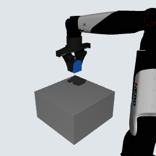

# Issue #27：单条 Simulation MVP → LeRobot → OpenPI π0.5

**`LEROBOT_EPISODE_READY`**。离线导出恰好1条682帧的LeRobot v2.1 Episode，真实OpenPI π0.5数据集、transform和batch读取通过。新增MuJoCo积分 **0步**，没有抓取重跑、碰撞资产修改、训练、checkpoint下载或Hub上传。

本轮只处理[Issue #27](https://github.com/LeoandDream/Nero_Gripper_assets/issues/27)。独立工作树 `/data_robot/projects/.worktrees/nero-gripper-lerobot-episode`，分支 `feature/mvp-lerobot-episode`；起点为用户指定的已验收MVP。数据语义先在提交 **`594eb1c`** 冻结，协议SHA `351806c0269eb49e29294e45ccfdf6cd4e47566a4a79d7cf7cb1a7b3a5d272b6`；后续API修正没有改变协议。

## 数据与语义

数据目录：
`/data_robot/projects/.experiments/nero-mvp-lerobot-issue27-20261020/lerobot/local/nero_mvp_r1/`

1 Episode、682 frames、20 Hz，1个Parquet、1个AV1 MP4及v2.1 metadata，总计 **1,371,202 bytes**。RGB为256×256×3；原PNG、时间索引、诊断sidecar、输入封存和执行日志位于同一实验目录的上级。数据/视频没有加入Git。

- `observation.state`：`joint1..joint7`实际位置(rad)，接着`gripper_joint1/2`实际滑块位置(m)，固定9D。
- `actions`：8D绝对位置目标，来自原记录 **`requested[k+1]`**；前7维为关节角rad，第8维为整个夹爪宽度m。不是`ctrl`、不是实测下一帧位置，也不把两个滑块变成两个动作。
- 源`Recorder.step`先apply→积分→forward→record，故行k是积分后观测；行k+1的requested是之后第一段1ms控制区间使用的目标。分段余弦插值在每10ms命令更新时调用set_target；requested是插值后的目标，command再经slew限制；其9D力/力矩ctrl来自反馈控制器。数据不把requested误称为最终waypoint，也不将command静默替换成VLA动作。
- `command`、9D `physical_target/ctrl`、qvel、cube、phase保存在sidecar；成功信息留在源Run，均不进入模型输入。
- 任务为事后统一标注：`Pick up the cube and hold it above the table.`，不是原控制器使用的自然语言输入。

### 时间对齐

源34150行，首行物理时间0.001s。选择真实物理0.05、0.10、…、34.10s，`observation_row=49+50*i`；动作取该行后一行。LeRobot相对timestamp为`i/20`，因此其0时刻是源0.05s，**没有伪造物理t=0状态**。34.15s终态没有后继动作，不导出；最后一行有效动作仍来自真实34.101s控制步。

| 样本 | frame | 源观察row / 时间 | 源动作row | 有效horizon动作 |
|---|---:|---|---:|---:|
| 开始 | 0 | 49 / 0.05s | 50 | 10 |
| 中间 | 341 | 17099 / 17.10s | 17100 | 10 |
| 尾部 | 681 | 34099 / 34.10s | 34100 | 1 + 9 padding |

完整[682行映射](issue27-alignment.csv)。全682帧Parquet状态/动作与源对应float32值逐项一致，frame_index、timestamp、episode/task边界全部检查通过。50ms区间内requested相对第一条采样目标的最大变化：arm任一维 **0.009958801rad**，gripper **0.003430290m**；各维中位数均0。该20Hz目标序列不是原1kHz闭环控制的无损重放，模型输出必须按现有8D Controller.set_target语义解释，不能直接写9D力ctrl。

## 干净RGB

用保存qpos/qvel/time恢复每个真实采样帧，原MuJoCo **3.2.3 / EGL** 下只执行mj_forward与offscreen render；mj_step函数显式改为抛异常的防护，实际调用0次。模型及碰撞资产未修改；只通过MjvCamera指定固定外部视角：lookat=(-.30,0,.20)m、distance=.75m、azimuth135°、elevation−25°、fovy45°。真实场景camera的pos/forward/up/frustum与全部原资产SHA、682张PNG SHA保存在[manifest](issue27-manifest.json)。

只显示原visual与桌面/物体，没有字幕、时间、成功标签或碰撞代理叠层；没有腕部相机。机器人根部部分在视野外，桌面、目标cube与执行抓取的手指可见；抓持时真实手指会遮挡cube的部分表面，未做图像修补。以下为原始第580帧（物理29.05s），无叠字：



LeRobot默认AV1/YUV420为有损编码；被检查视频帧相对对应PNG的像素MAE为 **0.884–0.915 /255**，不声称MP4像素无损。

## 真实OpenPI验收

锁定OpenPI **`215abfb217dbac7d5f1273282331b9b1866c0479`**，LeRobot **`0cf864870cf29f4738d3ade893e6fd13fbd7cdb5` / format v2.1**。沿用既有环境，没有升级安装；torch2.7.1、torchvision0.22.1、datasets3.6.0、pyarrow20.0.0、torchcodec0.4.0、NumPy1.26.4。渲染与OpenPI使用各自既有解释器；OpenPI环境内另装的MuJoCo2.3.7没有参与渲染或动力学。

实际调用：`create_torch_dataset` → 官方`TransformedDataset`任务prompt → `transform_dataset` → **`create_torch_data_loader`**。使用 `Pi0Config(pi05=True,action_horizon=10,action_dim=32)`、原PI05 `ModelTransformFactory`、缓存真实Paligemma tokenizer；未构造模型权重、没有checkpoint加载。

转换链为 **RepackTransform → NeroInputs → Normalize(skip_norm_stats) → InjectDefaultPrompt → ResizeImages → TokenizePrompt(discrete_state_input=True) → PadStatesAndActions**。没有DeltaActions；独立NeroOutputs完整返回8维，测试和实数chunk roundtrip都通过。单个真实外部图像进入base槽；两个缺失wrist槽是零padding且mask=false，不是虚构相机数据。

| 实际读取结果 | shape / dtype |
|---|---|
| LeRobot视频读帧 | (3,256,256) float32，范围0..1 |
| 逻辑状态 / chunk | (9,) / (10,8) |
| transform后状态 / chunk | (32,) / (10,32)，新增维度为0 |
| 真正batch状态 / action | **(3,32) / (3,10,32)** |
| 真正batch RGB | **(3,3,224,224) torch.float32**，范围−1..0.866667；原OpenPI PyTorch分支转NCHW |
| token batch | (3,200)，真实tokenizer输出 |
| camera masks | base=true，left/right wrist=false |

开始、中间、最后10步的边界、最后9步和末帧均读取通过。LeRobot原生索引clipping会重复末动作，但对应 `actions_is_pad` 明确为true；末帧mask为`[false,true×9]`。没有跨episode，也没有把重复值当成额外真实动作。

**训练前仍需处理**：本轮明确`skip_norm_stats=True`；需先计算适合NERO的归一化统计。当前DataLoaderImpl只返回Observation/actions，会丢弃额外action padding mask；虽然mask在原始/transform样本中已验证保留，后续训练仍须排除最后9个不完整chunk起点，或实现masked loss。本次不修改训练框架，不宣称数据已经可以不经处理直接微调。仅一个脚本专家Episode，不代表规模、多样性或泛化。

## 复现与证据

在本独立工作树根目录执行；以下OUT须换成全新目录，读取已有数据只运行最后一条并换新report路径：

```bash
OUT=/data_robot/projects/.experiments/nero-mvp-lerobot-issue27-reproduce
RENDER_PY=/data_robot/projects/.worktrees/nero-gripper-grasp-diagnosis/.venv/bin/python
OPENPI_PY=/data_robot/projects/official_pi05_libero/server-venv/bin/python
OPENBLAS_NUM_THREADS=1 "$RENDER_PY" -B experiments/dynamics/mvp_lerobot_episode.py prepare --output "$OUT"
MUJOCO_GL=egl OPENBLAS_NUM_THREADS=1 "$RENDER_PY" -B experiments/dynamics/mvp_lerobot_episode.py render --output "$OUT"
OPENBLAS_NUM_THREADS=1 "$OPENPI_PY" -B experiments/dynamics/mvp_lerobot_episode.py export --output "$OUT"
JAX_PLATFORMS=cpu OPENBLAS_NUM_THREADS=1 HF_HUB_OFFLINE=1 TRANSFORMERS_OFFLINE=1 \
  OPENPI_DATA_HOME=/data_robot/projects/official_pi05_libero/cache/openpi HF_LEROBOT_HOME="$OUT/lerobot" \
  "$OPENPI_PY" -B experiments/dynamics/verify_mvp_openpi.py --output "$OUT" --report "$OUT/loader-check.json"
"$RENDER_PY" -B -m unittest discover -s experiments/dynamics -p test_mvp_lerobot_episode.py
```

源码：[转换](../experiments/dynamics/mvp_lerobot_episode.py)、[NERO适配](../experiments/dynamics/nero_openpi.py)、[真实loader验证](../experiments/dynamics/verify_mvp_openpi.py)。3项针对性语义/8D roundtrip测试通过；没有运行资产回归或新增物理Episode。

实际prepare、render、修正后的export及loader验证均退出0。首次export因本地timestamp类型要求在写入任何帧前失败，空目录保留在`failed-export_001`；改用API自动timestamp后导出唯一完整Episode。首次loader验证把PyTorch batch误当NHWC，检查原源码后修正为NCHW；只重读数据，未重渲染或改数据。原失败日志、每阶段源码、成功日志与退出码均保留，未覆盖源Run。

[完整执行/版本/相机/资产/数据SHA清单](issue27-manifest.json)、[真实读取结果与5组索引检查](issue27-loader.json)、[render日志](issue27-render.log)、[export日志](issue27-export_002.log)、[真实loader日志](issue27-loader_002.log)。数据、视频、PNG序列及sidecar仅留Ubuntu独立实验目录，不上传Hub。

完成后停止。下一步唯一建议：ChatGPT独立审查动作时间对齐及尾部mask处理，再决定后续数据生成；本轮不训练。
