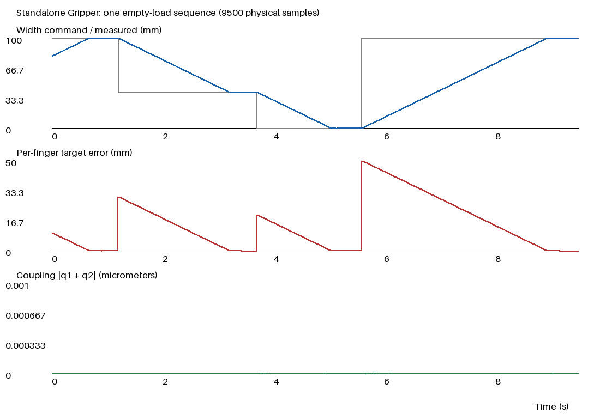

# Issue #35 — 独立 Gripper 与三级资产索引

**GRIPPER_STANDALONE_READY**，范围仅为静态来源等价与一次短时空载控制。独立分支 `feature/gripper-standalone-catalog` 从 `77bd26a58df4eda99f611de7be1013d714ddaa7f` 创建；没有改动冻结整机、mesh、原控制器、R1、便携包、Episode或训练。

| Issue验收项 | 结果 | 证据范围 |
|---|---|---|
| GRIPPER_STANDALONE_LOAD | PASS | MuJoCo3.2.3直接加载；nq=nv=2、nu=2、neq=1，699 geom / 353 mesh / 5 body |
| GRIPPER_SOURCE_EQUIVALENCE | PASS | 对照原MVP编译结果：3个夹爪body、2个joint/actuator、equality、所有699 geom、353 mesh和3种material；243,951对geom接触资格零差异 |
| GRIPPER_EMPTY_LOAD_CONTROL | PASS | **仅1次、9500步、9.5s**；open→middle→close→reopen，原跟踪/耦合/速度/限力及数值健康标准通过 |
| ASSET_CATALOG | PASS | components / assemblies / scenes都有实际入口/索引，未来资产仅PLANNED，无空占位资产 |

## 实际交付及来源

- [资产目录](../assets/README.md)；[独立组件XML](../assets/components/gripper/gripper.xml)、[依赖/SHA清单](../assets/components/gripper/manifest.json)、[组件使用说明](../assets/components/gripper/README.md)。全部692个MVP手指碰撞geom、4个基座碰撞geom和3个visual保留；共享原仓库353个mesh及3张纹理，**没有新生成/复制碰撞网格**。
- [原组合索引](../assets/assemblies/nero_gripper/README.md)指向旧静态整机及原MVP，不制造第二套权威合体；[R1场景索引](../assets/scenes/r1_cube_grasp/README.md)说明桌面/cube属于场景。
- [提取脚本](../scripts/extract_gripper.py)直接提取唯一冻结来源 `mjcf/simulation_mvp.xml` 的夹爪子树、equality及原两个限力执行器；核验来源commit及原MVP manifest。不使用旧整机的简化手指碰撞，不重建凸包/代理。
- [最小反馈与运行入口](../examples/gripper_control.py)；[静态测试及离线Run复核](../tests/test_standalone_gripper.py)。目录总清单见PR diff；研发历史继续保留原路径，没有迁入组件运行依赖。

安装座 `flange_mount` 固定在原点，代表源 `flange_link` 坐标；保留其到 `gripper_base` 的 `xyz=(0,0,0.006)m, rpy=(0,0,0)`。不包含NERO七轴或法兰碰撞。基座和手指质量/惯性、局部变换、两slide轴与range、默认qpos、材质、接触参数及关节联动均与源一致。

三个静态开口 `w=0,.04,.1m` 下，源整机世界姿态先换算到法兰安装系，再与独立组件全部699 geom实测对照：最大位置误差 `2.220446049250313e-16m`、旋转矩阵元素误差 `1.6653345369377348e-15`。不是仅比较导出XML自洽。依赖通过相对路径解析，358个XML/控制脚本/mesh/纹理文件逐项SHA；manifest自身作为第359个项目运行文件，在运行前封存和本报告JSON中单独记录SHA，避免自指。没有ROS、网络、NERO根模型或旧工作树绝对路径依赖。单拷XML无网格不保证加载。

新组件XML SHA256：`2632f9b7c1d3867966e4bc08f2f4cd4b1146a4a2aef75ba3d01b1462479dd0a1`。

## 唯一必要的固定根适配

初版直接固定根的参数/变换检查虽通过，却额外启用基座—手指装配接触：三种开口产生238/239/264条contact，最深21.663mm。该版本**只做静态forward，实际mj_step=0**；原始XML、manifest和`static_001`记录保留，并明确标为 `STATIC_CONTACT_EQUIVALENCE_FAIL`，没有当作可运行交付。

原因是源基座焊接在移动link7（weldid8），拆出后焊接到world（weldid0）。[MuJoCo3.2.3父子过滤源码](https://github.com/google-deepmind/mujoco/blob/3.2.3/src/engine/engine_collision_driver.c#L135-L150)对world焊接体不应用通常的父子排除。组件因此显式保留 `gripper_base↔gripper_link1/2` 两组源模型原有的隐式过滤；这不新增物理排除语义，也没有禁用手指之间的接触。

修正前有2,768对geom资格差异；修正后全部243,951对资格逐对相同，保留119,716对可接触的手指geom组合。w=.04/.1时无内部contact；w=0时仍有2条手指—手指接触，最大穿透约 `1.54e-10m`。没有通过改几何、惯性、摩擦、solver、equality或控制参数消除装配重叠。

## 一次空载实测

实际执行源码提交 **`ae53de73553dc51919cb287e684280171022b264`**，运行前封存script、manifest、358个依赖SHA、版本和协议。Ubuntu / Python3.11.9 / MuJoCo3.2.3 / NumPy1.26.4。初始 `w=.08m`；唯一序列：`.1m×1.2s → .04m×2.5s → 0m×1.9s → .1m×3.9s`。

命令为1D绝对开口坐标，目标 `(+w/2,-w/2)`，不是标定指尖净距。沿用源 `kp=800N/m`、原生 `kv=8Ns/m`、限力±10N、width限速.03m/s，100Hz更新目标、1kHz反馈与积分。与原控制器相同的比例反馈+bias feedforward，速度反馈由原执行器实现。初始化之后不写qpos，不施加外力，不修改仿真状态获取结果。

| 指标 | 实测 | 原适用标准 |
|---|---:|---:|
| 四阶段末250ms最大单指误差 | `5.224377251154763e-11m` | ≤0.5mm |
| 全程最大耦合误差 `|q1+q2|` | `2.0631562639923434e-13m` | ≤0.2mm |
| 最大单指速度 | `0.016906790520638655m/s` | ≤0.1m/s |
| 最大实际执行器力 | `0.09090909748053774N` | ≤10N |
| 对限速后目标的全程最大单指误差 | 0.208413mm | 记录，未新增验收阈值 |
| 瞬态软限位最大越界 | **1.806455µm** | 原软限位保留；没有声明实际状态严格零越界 |
| 最大指间穿透 | **3.412747µm** | 如实记录，未放宽既有接触标准 |
| 最大contact / solver迭代 | 5 / 2 | 记录 |
| 数值warning / 时间reset / 外部施力 | 0 / 0 / 0 | 原健康要求 |

物理序列执行退出码0，9500个逐步样本；积分及指标记录墙钟5.78s，含加载/封存/绘图的命令墙钟6.84s。随后只对保存NPZ做NumPy重算：阶段末误差、耦合、速度、执行器力与runner一致，采样时序、100Hz目标更新、限速和外力零值均通过；**复核新增积分为0**。6项静态测试已通过，没有为本轮运行旧全量动态测试或R1。



灰线为阶段最终请求，蓝线为积分测得的关节开口坐标。第二图对阶段最终请求的误差包含计划内限速运动，不是相对当前限速命令的控制滞后；验收使用各阶段末250ms。图和原始数据均来自这次新积分。

## 证据、命令与边界

- [机读报告](issue35-standalone-gripper.json)：全部状态、静态/物理/离线结果、协议、版本、命令、源SHA及原始文件索引。
- [完整9500步NPZ](issue35-gripper-trajectory.npz)（220,622 bytes）和[实际日志](issue35-gripper-control.log)。与原Run字节一致；其他原始文件保留在 `/data_robot/projects/.experiments/nero-gripper-standalone-issue35-20261023/`，`empty_001`为唯一物理Run。
- 原完整环境使用 `/data_robot/projects/nero_gripper_assets/.venv/bin/python`；任意安装仓库requirements的Python3.11环境可从根目录使用以下相对路径命令。

```bash
# 直接加载；不积分
python -c "import mujoco; m=mujoco.MjModel.from_xml_path('assets/components/gripper/gripper.xml'); print(m.nq,m.nv,m.nu,m.neq)"
# 静态来源对照，不调用mj_step；输出文件须不存在
python tests/test_standalone_gripper.py --report /tmp/gripper-static-new.json
# 会新增一次短时物理序列；本轮完成后没有再次执行
python examples/gripper_control.py --output /tmp/gripper-empty-new
# 仅复核原始Run，不加载模型或积分
python tests/test_standalone_gripper.py --run /data_robot/projects/.experiments/nero-gripper-standalone-issue35-20261023/empty_001 --report /tmp/gripper-offline-new.json
```

未来 `left_` / `right_` 对body/joint/geom/actuator/equality/site及引用做确定性命名；mesh/material/texture共享只注册一次，或各自加前缀。安装frame为 `left_flange_mount` / `right_flange_mount`。这些只是文档约定，没有双臂模型、加载器、控制、占位目录或预设双臂action向量。

固定R1 PASS、研究几何BLOCKED、长保持UNKNOWN和既有legacy MPR接触限制沿用冻结证据，本轮未复测，也未追认独立抓取、复杂manipulation、双臂或实机真实性。模型、mesh、原控制器及阈值对基线无改动。独立Draft，不合并main；完成后停止，等待ChatGPT独立审查。
