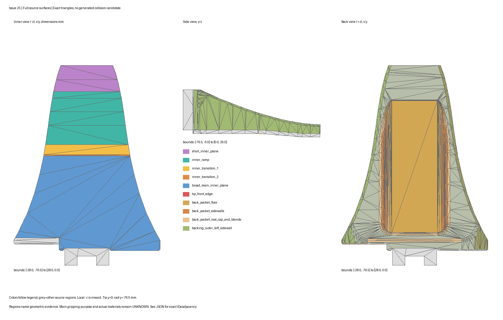
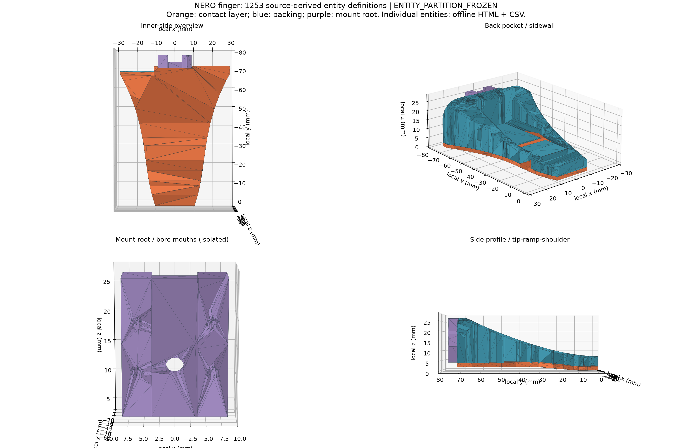

# Recommended NERO Gripper Collision Architecture v1

Issue [#25](https://github.com/LeoandDream/Nero_Gripper_assets/issues/25)，2026-10-19，Ubuntu 22.04。**唯一推荐：完整功能接触层＋有语义的侧壁/背体/安装框架。** 不再以中心矩形 pad 加顺序切割 guards 表示工作面，不预设 Panda 的 pad 数量。

**当前阶段：`V2_RUNTIME_ENTITY_PARTITION_BLOCKED`。** 严格使用`8a5518b`冻结规则，已生成唯一一版346体/指的v2候选；最小实体尺度通过，但union exterior独立认证未通过。新结果见[v2报告](nero-gripper-v2-runtime-partition.md)、[候选JSON](nero-gripper-v2-runtime-partition.json)及[对比图](nero-gripper-v2-runtime-comparison.png)。[v2分类与规则](nero-gripper-v2-fidelity-protocol.md)保持不变。原753体候选仍为`RUNTIME_ENTITY_PARTITION_BLOCKED`，历史见[报告](nero-gripper-runtime-partition.md)。§1–7保留来源、外壳分析及reference历史记录，均不表示runtime验收通过。未生成/编译MJCF。

## 1. 来源与坐标

基线 `feature/panda-gripper-reference@d4a37dafb9a7b9cb3392a8937590dd091a5e4a7a`，独立文档分支 `feature/collision-architecture-v1`，不继承 #23 candidate 开发分支。固定来源与逐文件 SHA 见 [来源清单](nero-gripper-collision-sources.json)：

| 来源 | 冻结版本 | 本轮核查 |
|---|---|---|
| NERO URDF/Xacro、STL、DAE | `agx_arm_urdf@a68b8e876a2c6fcb0ecee7a7943129e4d48dd864` | 装配/关节引用、原始表面、转换后的 visual 与000/001 |
| Official NERO MJCF/STL | `agx_arm_sim@f8cd8b147c75d59e14f90fb0646770eefa268ed0` | 每指整份mesh collision；两份指 STL 与 URDF 源逐字节相同 |
| Menagerie Panda | `62ab00f2bc44f6f20c1c9b7a13f3fb1dd41a4e35` | `panda.xml`、`hand.xml`、README、`finger_0/1.obj` |
| robosuite Panda | `5ce6643f3092639d08f7b0f90ed1c6a84f50552c` | gripper XML、`finger.stl`、visual、动作边界的既有审查 |
| MuJoCo3.2.3文档源 | `476599f8b6175ef5a3040c47ebb3cd99a83c5365` | 普通mesh的凸包语义、碰撞mask语义 |

每指 **2086个源三角片，分为37个不重复区域，遗漏0**。这是源三角片库存的完整性，**不等于装配外表面已完整认证**。STL以文件三角形顺序、OBJ以`f`行顺序从0编号。DAE到STL顶点差≤约97.2nm、源到visual≤约95.8nm；不能按重排后的三角片或编译mesh主轴坐标解释索引。左右指对应三角片坐标最大差约`1.77e−18m`。

mesh与finger body局部帧一致：`y=0`是指尖、负y朝根部、`−z`朝夹持内侧；侧壁以局部`±x`命名，避免混同世界左右。指体在gripper_base中近似`z_base=138mm+y_local`。整指范围约`x±28mm, y[−76.5,0]mm, z[0,26.5]mm`。

## 2. 一根手指真实有哪些区域

下表是源几何证据及**本架构的用途建议**；“主接触”不是厂商已标注材料/用途。完整37区的三角片、范围、法向分布、平面边界点和邻接见 [结构化清单](nero-gripper-functional-regions.json)。曲面不能用平均法向替代。

| 区域 / 源STL三角片 | 局部位置与法向 | 物理职责建议与相邻关系 |
|---|---|---|
| 大内平面：557–577 | y约−71..−34.71785mm，z=2mm，n=(0,0,−1) | 主内接触候选；接过渡面、薄层侧缘和根部缺口；不是仅因“靠根”就只防碰 |
| 指尖短内平面：545–548 | y=−10.02218..0mm，z≈0，n=(0,0,−1) | 精细指尖夹持候选；完整渐宽六边形，接ramp、两侧缘、tip端面 |
| 内斜面：549–556 | y=−30.33513..−10.02218mm，z=1.80560..0mm，n≈(0,−.088540,−.996073) | 斜抓/导入/过渡接触；接短平面与肩部，不能用原凸包浅斜面替代 |
| 两段肩部过渡：578–579 / 580–581 | y=−34.71785..−30.33513mm，z=2..1.80560mm；n分别约(0,−.049474,−.998775)、(0,−.005166,−.999987) | 连续内轮廓的真实折面；辅助接触，非两种新材料pad |
| tip前缘：592–593、1962–1965 | y≈0，x±10mm，z约0..7mm，n=(0,1,0) | 探碰、插入、贴桌/推拨边缘；与短内平面及背体端部相邻，不是零厚度线或天然capsule |
| 薄层及背体两侧壁 | `thin_layer_*_sidewall` / `backing_outer_*_sidewall`；分布见JSON，主要朝±x，随轮廓倾斜 | 侧抓/推拨和防碰；接工作面真实taper边、tip、外背面，不能留下“朝内侧缘guard”承担同一工作面 |
| 外背面、凹袋及孔周 | `back_outer_roof_and_transitions`、`back_pocket_*`、`backing_*_bore` | 外侧接触与保护；背袋底约z8.22..9.63mm，外壳最高z26.5mm；不得用一个大凸包封闭源袋口 |
| 根部安装块：0–503 | x±8.5mm、y约−76.5..−70mm、z4..26.5mm；多方向法向 | 安装/环境防碰，非本架构预定夹持面；源含缺口、四个凹座和中心孔，装配态占据仍UNKNOWN |
| 薄层背面504–541与承托接口660–697 | z约2..4mm，近重合反向表面 | 内部共享子域已核验；不另发射一层暴露“抓取pad”，相连外缘/微缝另保留，见§6 |

三个关键修正：

- 大内平面面积约 **1492.611mm²**，明显大于短平面229.624mm²和ramp585.146mm²。内轮廓5组共37个三角形的质心均为从夹持侧进行源三角形射线检查的首交；不能用过去cube触点把大平面排除。该采样不证明所有点可达或厂商实际用途。
- 大平面是**非凸23顶点轮廓**，有中央根槽、较大的非对称左缺口及非凸侧轮廓。其二维凸包为1613.033mm²，多填 **120.421mm²（8.068%）**。单box/单凸面不能精确代表它；这个面积差不是运行时失效或抓取性能证据。ramp凸包也多填约0.049333mm²，不能悄悄忽略为零。
- 已知约2mm的是前薄层厚度依据，**不是整个指尖厚度**；tip端面到z≈7mm。四个背体y向孔、侧孔、根部凹座/中心孔以及背袋均已记录。源孔在实物装配后是否被紧固件或滑块占据尚不确定，既不能盲目封孔，也不能断言实物全部开放。

## 3. 唯一推荐的组件组织

所有名称加`finger1_`/`finger2_`前缀，保留在原finger body，仍为同一刚体。一个功能组件可含几个有源依据的凸实体；底层数量、子实体名称和封闭边界目前为UNKNOWN，禁止用匿名序号填充。

| 组件族 | 推荐primitive类型 | 源对应、职责和边界 |
|---|---|---|
| `inner_main_contact_plate` | 按源非凸轮廓分区的有限厚凸多面体组 | 拥有完整大内面及其真实边缘；不可只取中心矩形，不能填根槽/左缺口；是一个功能工作区，未必一个geom |
| `distal_tip_contact` | 源轮廓闭合polyhedral cap，凸细分待定 | 拥有短内面、真实tip前缘及相应侧边；不额外叠一个capsule；外部轮廓及薄层/背体接口已由源几何确定，具体实体分区尚未实现 |
| `inner_ramp_contact` | 源斜面楔形凸多面体组 | 拥有完整渐宽斜面；不把两侧真实夹持条带留给“防碰”代理；保留真实微小非凸边界 |
| `inner_transition_contact` | 按真实肩部两facet组织的凸楔组 | 分别命名`shoulder_bevel`/`shoulder_blend_facet`等物理区；连接大内面与ramp，不复制Panda小box |
| `sidewall_negative_x` | 保持源外轮廓的凸侧壁/框架片 | 负责剩余背体−x侧壁；前述接触实体已拥有的侧边不再次覆盖；辅助操作与保护 |
| `sidewall_positive_x` | 同类凸侧壁/框架片 | 对应+x侧壁；必须尊重左右不对称缺口，不能盲目镜像一张AABB |
| `outer_chassis` | 保留凹袋/孔口的语义凸框架 | 负责外背、袋边、孔周与背体根帽；“粗粒度”仅指次要细节简化，不准整体凸包把可达空区填满 |
| `mount_root` | 保留缺口的安装框架凸分组 | 负责源安装块；未来子体应对应真实安装侧耳、桥部等；保留已知源孔槽/唇口，不依赖未知紧固件用途反推实体 |

这套架构选择的是**一个完整主内接触区＋几何所需的tip/ramp/shoulder辅助区＋侧壁/背体/安装框架**。不是“一个矩形主pad”，也不是“每个区域恰好一个primitive”。不根据历史某帧结果选择切口或移动几何。

`collision_000`当前把主体与短平面合成凸包，跨越多个功能区；`collision_001`是安装块的包围凸体，也填其缺口。**v1建议两者都只作历史参考，未来活动表示由上述语义组件整体替代/重新组织**，不在原000/001上继续叠pad。原文件、SHA和已验收机械字段保留；本轮实际未替换任何文件。

职责约束：完整工作面及taper边缘必须有唯一解释的外边界归属；内部封口面保持在实体并集内部。真实相邻面可同时接触同一物体，**多contact本身不是重复约束证据**；禁止未解释的同工作面多重代理。薄层侧缘跨多个接触区，源外部轮廓已经确定；具体组件分界和内部封口是下一步工程设计，37区库存仍不等于最终geom映射。

**不建议新增explicit contact exclude。** 保留既有冻结配置；同finger内无需为几何组件添加body对排除。“防碰”是用途说明，不是关闭对cube或其它任务物体的碰撞/摩擦；侧壁、背体、安装区对所有可达物体、桌和环境仍应正常传力。不能靠过滤掩盖不良几何。

## 4. 与已有实现的关系

| 实现 | 可迁移的原则 | 不能照搬或过度推断 |
|---|---|---|
| [Official NERO][O] | 源整指轮廓自然包含内面、侧壁、背体和安装形状；同一finger/关节结构 | [普通mesh碰撞按凸包][D]，凹斜面、根槽、背袋和孔口可能被填；URDF/STL来源正确不等于碰撞表面正确 |
| [Menagerie Panda][P] | 手工显式tip局部表示，同时保留finger body保护 | 五box不是五个真实独立部件；大box近似中央后退区、四小box近似四角近共面的区；大box与四小box、且与finger_0碰撞凸包存在重叠，不能据名字保证互斥或材料真实性 |
| [robosuite Panda][R] | 简单pad＋finger mesh的命名、关注区域组织 | 单box也与mesh凸包重叠；其mask仍允许body接物。不能说mesh只防碰、pad独占抓取；不同摩擦和servo不能迁入本轮NERO |

本轮对固定XML/源mesh进行纯几何复核：Menagerie大box与两上小box分别重叠90mm³、与两下小box分别105mm³，也与`finger_0`凸包有正体积交叠；robosuite单box与finger凸包也有正体积交叠。**这只说明近似组成，不是新接触查询或性能比较。** 保留finger mesh的意义是覆盖局部pad以外的实体；不能神化为其全部几何职责已经隔离。源码及几何依据的路径/SHA见来源清单，本地详细审查保存在`debug/issue25/reference-audit/`。

上一版guards不适合作为长期架构的原因是**由矩形棱柱切割顺序决定子块，而非完整真实功能面与实体结构**：朝内taper边仍交给了“保护体”，难以解释未来斜抓、侧推和孔槽附近接触。不是因为“12个太多”；将`guard_2`改名也不能修复职责。#23已存第一帧共存只是隔离未明的证据，没有证明重复力，本轮未继续修该候选。

## 5. 不改变控制语义

维持2个finger slide joint、原equality、两个finger actuator，以及kp/kv/force limit、friction、solver/nativeccd和action adapter。上层仍为 **`[J1..J7,w]`的8D绝对目标**，arm用rad，`w∈[0,.1]m`，`q1*=w/2, q2*=−w/2`，w增加表示开口增加；内部仍是7 arm＋2 finger的9路限力ctrl，不迁移Official单伺服或Panda tendon。

`w`是源虚拟命令坐标，**真实净指间距尚未标定**。在理想对称、同截面实际关节姿态下，源对向内面可写`gap(y)≈q1−q2+2*z_inner(y)`：短面z≈0，大内面z≈2mm，二者几何开口差约4mm。因此不能把一个标量对所有工作区都叫“真实净间距”，更不能改adapter弥补新几何。碰撞角色元数据不改变动作、观测或成功判据。

## 6. 续轮：externally reachable collision shell

本节替代前轮的总体外壳UNKNOWN判断，基线为`e7bdfe262e376cb7326229d1bcc82a233850c853`，沿用同一Issue/PR。只判断**冻结源装配中会决定外部首次接触的边界**，没有完整CAD重建，也未生成新collision candidate。现有资产已足够，不需要厂商CAD或实物测量来开始源几何一致的实体设计。

### 外露面清单

- **内夹轮廓**：短平面545–548、ramp549–556、主内面557–577、肩部578–581；保留完整非凸边界及taper边缘。
- **tip、侧壁、外背壳**：tip端面592–593/1962–1965、薄层侧缘、两侧背体、外背顶及其过渡；具体源片范围仍见37区JSON。
- **背袋和已知孔口**：袋底/侧壁/根帽及五组背体小孔都有源点外界路径。大背袋不能因为40mm cube进不去就填平；未来环境没有被擅自限定最小特征尺寸。孔口、唇缘和已知源孔壁保留。
- **根部安装区的外露部分**：内/外平面2–8/12–18、左右面9–11/19–21、四凹座109–448、槽底480–499及槽壁500–503上沿；rootward cap0–1/107–108在合法大开度出现外露。不能整块当内部安装件删掉。
- **源已知微缝及窄侧带**：薄层526/527和背体682–685的微缝有外界直线路径，接口边缘79个差集子多边形各保存一个外露点见证；mount/backing贴合面的孔口环带、约0.15mm侧带仍是已知源边界。保留唇口和源空区，不以“内部细节”名义删掉。

两指各对1506个非安装块/非薄层接口源三角形进行质心筛查，**各1444个质心有无遮挡外界路径**；未获见证的62片由根部贴合专项处理，未按采样阴性删除。装配遮挡使用原STL、精确XML/URDF frame和合法开度，包含gripper_base及双指，而非已有凸代理。根部再用开度0/25/50mm、剖面、近边缘与低角度路径补足质心会漏掉的槽底、槽壁和孔口环带；五类代表见证×双指经独立全三角形求交复核，10条均CLEAR。

**证据边界**：外部路径是点/局部部分的正证据，不是“全三角形、全开度、所有有限尺寸物体均可达”的证明。有限射线失败不证明内部；表面在某一合法开度被基座遮挡，也不等于可永久移除。原40mm cube/桌面只是接触体实例，不作为环境最小尺寸假设。

### 确定内部接口清单

1. **薄层背面504–541与承托面660–697的内部共享子域**：三个源part分别闭合；安装块/薄层拓扑索引实际合并点的最大差仅约`5.37e−19/1.32e−17m`，背体原坐标已闭合，没有改源坐标。逐对投影裁剪及仿射间距将112个重叠子域中86个判为材料交叠/贴合内部域。不能只看反向法向，也不能把76片整组删除；30片相对内部完全被覆盖时仍保留相关外缘边界。
2. **安装块tipward cap22–106与背体cap1444–1501在y=−70mm的共享子域**：共享面积 **358.356327mm²**。两侧仍分别余 **4.585511/13.613670mm²**，包括孔口环带与窄侧带，不能当整片内部。JSON给出完全共享的face interiors和残余规则。
3. **19条非流形叠加边**：5条仅为接口叠加三角化边，14条连接接口与外侧面；不是19个开放破洞。内部重合三角片无需单独对外接触，但相连真实外壁、侧缘和唇口保留。

接口有 **−1.207至+9.005μm** 的真实源几何差；9μm楔隙不是nm级数值噪声，其中已证开放部分属于外露源微缝。其几何已经确定，无需再猜真实装配是否将其填满；本轮没有简化填缝或改变原1mm物理标准。

### 可忽略UNKNOWN清单

| UNKNOWN | 本轮为何不阻断 | 必须保留的边界 |
|---|---|---|
| 孔深部纹路、螺钉/嵌件用途、内部占据 | 现有源孔口、空区和壁面明确，没有证据要求新增一个不同的突出外形；无需重建内部紧固件才能开始源壳层设计 | 不据未知占据封孔；不省略可达槽底、环带或大背袋 |
| 19个小于已观测源输出差异的正缝子域能否被探针进入 | 坐标与外缘已知，保留源轮廓即可；不能从表示差异宣布真实机械缝或调整容差 | 源唇口不移动，不填9μm真实开放楔隙 |
| 中央孔449–479深部、未穷尽的窄通道路径 | 孔几何已给定；继续证明每个内点是否可见不改变保留的首次接触边界 | 已知源形状保留，不把有限probe阴性当封闭证据 |
| 背体1514/1515/2082/2083在0.15mm通道中的完整可达性 | 壁位置及对侧x=±8.5/±8.65mm边界明确；保留两侧源壁，无论某探针能否进入都不需要另猜外形 | 不标为全内部，不填通道 |
| 真实材料、实物精配合、任意物体的连续全域可达性 | 不决定本轮源壳层边界，属于另一个验证问题 | 不据此改friction、控制、动作语义或宣称硬件标定 |

### 仍然重要的UNKNOWN

**无仍会改变当前源外部碰撞壳层、且必须额外获取CAD才能消除的几何UNKNOWN。** 本结论以冻结资产为依据，不宣称已完成真实硬件测量。没有以删孔、整块删root、关闭body对物体碰撞、或放宽验收标准来消除未知。

### 八个组件族是否足够开始实体设计

| 组件族 | 外露边界是否足够 | 后续设计必须保留 |
|---|---|---|
| `inner_main_contact_plate` | 是 | 完整主内面、非凸缺口、真实侧缘 |
| `distal_tip_contact` | 是 | 0..7mm真实tip外形，不能用2mm薄层代替整端面 |
| `inner_ramp_contact` | 是 | 斜面、taper轮廓、已知微缝唇口 |
| `inner_transition_contact` | 是 | 两个真实肩部facet及连接外缘 |
| `sidewall_negative_x` | 是 | 源侧壁和根部窄侧带，非采样阴性删除 |
| `sidewall_positive_x` | 是 | 对侧独立源轮廓，保持不对称细节 |
| `outer_chassis` | 是 | 背袋、已知孔口/空区、外背壳；只排除已证内部共享域 |
| `mount_root` | 是 | 状态依赖root cap、槽底/槽壁上沿、凹座/环带 |

**最终状态：`EXTERNAL_SHELL_CLOSED`。当前已足够开始设计具体collision实体，尚未生成或验收任何新实体。**

下一步只提出：在同一Issue #25中冻结具体源一致实体的分区、名称、内部封口和相邻职责边界；用本轮已知外壳约束选择凸分组，保留孔槽/唇缘，不把源级可见性UNKNOWN升级成任意删面。本轮到此停止，不实现candidate、不运行静态MuJoCo查询或动力学。

详细机器清单、两指代表路径、接口子域与八族readiness已追加到 [功能区域JSON](nero-gripper-functional-regions.json) 的`external_shell`；脚本/原始结果路径及SHA追加到 [来源清单](nero-gripper-collision-sources.json)。完整Ubuntu证据位于`debug/issue25/{external-shell,shell-interfaces,shell-mount,shell-review}/`，只读分析脚本留本地，不新增实验框架。前轮功能架构和材料/参数约束保持；本轮没有MuJoCo导入、模型加载、collision query、`mj_step`、Controller或候选生成。

[O]: https://github.com/agilexrobotics/agx_arm_sim/blob/f8cd8b147c75d59e14f90fb0646770eefa268ed0/mujoco/agilex_arm/agilex_nero/nero.xml
[P]: https://github.com/google-deepmind/mujoco_menagerie/blob/62ab00f2bc44f6f20c1c9b7a13f3fb1dd41a4e35/franka_emika_panda/panda.xml
[R]: https://github.com/ARISE-Initiative/robosuite/blob/5ce6643f3092639d08f7b0f90ed1c6a84f50552c/robosuite/models/assets/grippers/panda_gripper.xml

[D]: https://github.com/google-deepmind/mujoco/blob/476599f8b6175ef5a3040c47ebb3cd99a83c5365/doc/XMLreference.rst#L1110-L1116

## 7. 具体 collision entity partition — 本轮冻结交付

**状态：`ENTITY_PARTITION_FROZEN`。每指 1253 个闭合凸多面体，双指共 2506 个。** 这是唯一一版离线几何候选的设计冻结，尚未生成或编译任何MJCF，不是运行时可用性或抓取验收。依据[指定任务评论](https://github.com/LeoandDream/Nero_Gripper_assets/issues/25#issuecomment-6265270438)，不重复交付上一阶段结论。

逐实体的**语义名称、源区域/三角片、类型、外露子面、内部封口、邻接和overlap策略**完整列于[分区表CSV](nero-gripper-entity-partition.csv)；[权威JSON](nero-gripper-entity-partition.json)给出全部顶点、定向三角面、半空间和裁片坐标，CSV是由它生成的索引。37个区域没有机械对应37个geom。全部实体类型为`convex_polyhedron`，未将任何非凸大面直接取整体凸包。

### 固定数量与物理职责

| 源实体 | STL源片（0-based inclusive） | 每指实体数 | 分区依据 |
|---|---|---:|---|
| 接触薄层 | 504–659 | 50 | 源上下高度面叠置；tip/main/ramp/两肩部边界；精确有理数凸合并 |
| 承托背体 | 660–2085 | 945 | 源多区间材料剖分，保留背袋/孔道/侧壁；新增凸包面必须被原单元并集覆盖 |
| 安装根部 | 0–503 | 258 | 左右耳、中央孔桥、四凹座盲底与孔唇，按源slot/孔轴分区 |

| 语义组件族 | 每指实体数 |
|---|---:|
| `distal_tip_contact` | 18 |
| `inner_main_contact_plate` | 14 |
| `inner_ramp_contact` | 16 |
| `inner_transition_contact` | 7 |
| `sidewall_negative_x` | 88 |
| `outer_chassis` | 743 |
| `sidewall_positive_x` | 109 |
| `mount_root` | 258 |

两种肩部facet仍归同一`inner_transition_contact`族，具体实体保留`shoulder_bevel`/`shoulder_blend_facet`特征名。每一块都关联真实source区域与空间位置；没有`guard_N`或`part_N`。该数量来自源约束下的确定性局部凸合并，**不声称数学全局最少或轻量实时模型**。未复制Panda数量/尺寸，也没有使用历史cube结果选择切口。

### 外露面、内部封口与邻接的唯一事实来源

- `source_boundary_patches`是原**单个源part**的表面及源片/平面索引，不能直接等同装配外露面。
- 每entity的`source_surface_partition`才是装配外边界归属：`exterior_subpolygons`列实际外露多边形；`assembly_relation_subpolygons`列真实共享界面、原材料交叠埋藏域及数值分辨记录。均给出实际3D多边形，未用整片mixed标签代替。
- `internal_closure_patches`给出新分区封口的多边形和实际覆盖邻居。它们在同part并集内部，不被设计成环境首次接触面。`entity_face`索引本entity的`faces`；`support_plane_id`索引其`halfspaces_m`，约定单位法向`n·p+d≤0`。
- 同part不添加正体积overlap；薄层为精确有理数零交集证据，根部/背体为明确有限计算精度的闭合、覆盖及合并证据。真实相邻外面可以同时接物，不能因多contact预设重复力。
- 跨part共 1098 对实际关系，逐对多边形/量级保存在`cross_part_entity_relations`。其中 146 对有可分辨的**原源材料交叠**，总体积约`1.0756824247e−11m³`，没有新增inflation；没有正面积同法向重复外露面。原开放微缝、孔口环带和窄侧带仍保留。

共享界面和材料交叠只解释原闭合实体并集，不允许据这些标签删掉闭合mesh面、关闭body/root对外碰撞或添加filter。后续生成必须使用完整`vertices_m`/`faces`，不能只输出外露面成为开口壳。

### 旧代理替换与生成接口

`gripper_link{1,2}_collision_000`的活动实例**全部由薄层50+背体945替换**；`_collision_001`活动实例全部由安装根部258替换。旧文件保留历史基线，不能与新工作面叠加实例化。**本轮实际未替换任何active geom。**

JSON共享一份finger-local几何模板，分别放入原`gripper_link1/2`坐标系；不使用编译mesh主轴。两源STL对应坐标差最大约`1.77e−18m`已披露。`future_geometry_emission`列明确mesh命名、顶点/面路径、局部pos/quat和惯性策略，几何边界/实体数量没有留待runtime猜测的TBD。保留原body transform、惯性、joint、equality、两个finger actuator、kp/kv、friction/solver/nativeccd及8D action；不从新collision体积重算质量。

### 离线图与可复核证据

[离线逐实体三维图HTML](nero-gripper-entity-partition.html)下载后可直接打开；不依赖网络或MuJoCo。可按语义名、E编号或源三角片搜索，选择实体、聚焦、查看完整邻接。静态PNG是总览，完整1253行对应见CSV/JSON。

验证未把“总体积接近”当完整证明：

- 薄层156源片全部精确覆盖，422个人工封口裁片有精确邻居覆盖；源/并集有理体积相等。拓扑等价端点最大规范化`1.32e−17m`逐点公开，未改源文件。
- 根部504源片全覆盖；857个人工封口覆盖。独立longdouble几何差集复核未覆盖封口为0，源面积最大残余约`4.14e−20m²`；浮点LP不被描述为数学严格零交叠。
- 背体1426源片全映射；体积差约`2.87e−10mm³`、最大源片面积残余`5.94e−8mm²`、封口覆盖数值残余总计`6.66e−9mm²`。有限精度残余保留，未写成精确零。
- 近竖直源2021的遗漏正域用完整Fraction配对恢复；其面积差约`4.44e−16mm²`。源1858的误标封口由局部点到平面判别纠正，未移动几何，也没有通过放宽物理判据处理。
- 全局源裁片面积闭合最大残余约`5.42e−19m²`，真实shared对片残余最大约`4.00e−19m²`；9条极小边界分辨记录及1对约0.492pm公共内球记录仍保留，不额外声称精确符号或严格零。

原始计算及脚本保存在`debug/issue25/entity-partition/`各part与`global-interfaces/`中，路径/SHA见来源清单。全部为纯源几何计算，无MuJoCo导入、模型编译、引擎碰撞查询、积分、抓取或benchmark。旧Run未覆盖。

### 必须披露的限制与唯一下一步

**1253/指是较重的保真分区，而且包含亚纳米薄实体。** 独立计算的最小facet-normal宽度约`5.595e−11m`（0.05595nm），来自源facet微小翘曲；它不是实体实际制造尺寸的认证。没有为减少数量擅自粗化、删除这类正体积单元或引入新简化误差预算。精确几何设计冻结**不证明MuJoCo可编译、数值稳定、可实时运行或适合物理接触**。这些问题未在本轮运行；也未将最小厚度变成新增验收Gate。

**唯一下一步：交ChatGPT独立审查这版分区，重点评估复杂度与亚纳米单元；审查后再决定如何进入派生MJCF生成及静态验收。** 本轮到此停止。
