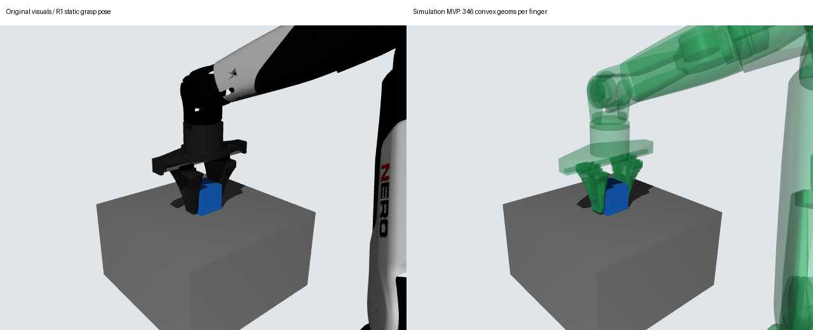

# Issue #25 — Simulation MVP

**`SIMULATION_MVP_ASSET_READY`**，范围为本次固定 R1 场景的工程烟测。一个完整真实 Episode 已通过原抓取与控制健康判据；没有调参、重试、运行偏移任务或修改 main。研究状态仍为 **`V2_RUNTIME_ENTITY_PARTITION_BLOCKED`**，没有追认严格几何认证。

任务：[6292634892](https://github.com/LeoandDream/Nero_Gripper_assets/issues/25#issuecomment-6292634892)。运行环境：Ubuntu 22.04、Python 3.11.9、MuJoCo 3.2.3、NumPy 1.26.4、SciPy 1.15.3；CPU 积分、EGL 静态导图。

## 可运行资产

- [MJCF](../mjcf/simulation_mvp.xml)：完整 NERO + Gripper、正常桌面、40 mm / 100 g 自由 cube、9 个原执行器与原双指 equality。
- [346 份共享凸网格](../meshes/collision/simulation_mvp)：每个原始 vertex/face 原样导出 OBJ；不是 v2.2/v2.3，也没有重新分区或修复几何。
- [692 项 entity→body/mesh/geom 映射及文件 SHA](../mjcf/simulation_mvp.manifest.json)：每个手指346 geoms，沿用原刚体坐标与姿态；同一刚体内允许内部重叠。删除的仅是该派生 XML 内双指原四个 `collision_000/001` geom 及其 mesh 声明；原文件保留。
- [R1 配置、动作协议与已存 IK 计划](../experiments/dynamics/simulation_mvp.json)：直接取自 Issue14 的 R1 原记录；没有重新规划、改初态或改控制器。7 arm + 1 gripper 的 8D 绝对目标接口不变。

基线 `6eba4f34c5ff5029eb849804e3d2e9c535f58756`；冻结几何 SHA：
`79bef01f443035c6db2213c0e73531c079cdb97762361e682d7c9d052edac84e`。

MJCF SHA：`db18a44f72ac62d6cd06bc4f9d4a7ef7ea38d36c43b5813064eb51b2f3ca8408`。
完整版本、依赖、命令、退出码及证据 SHA 见[执行清单](nero-gripper-simulation-mvp-provenance.json)。原 source/visual/惯性/关节、控制器、friction、solver、原研究 policy 和报告均未改动。接触配置为 R1 的 `elliptic / impratio=10 / nativeccd=false`，保留原 base_link↔link1 排除与其余原过滤。



## 实际检查

| 检查 | 结果 |
|---|---|
| XML / MjModel 编译 | PASS：14 bodies、10 joints（含 cube freejoint）、16 nq、15 nv、9 actuators、1 equality、764 geoms、416 meshes |
| 映射 / 左右坐标 | PASS：692/692 存在且属于正确刚体，全部源顶点与编译后世界坐标的双向最近距离 <20 nm；不是只检查数量 |
| 非碰撞部分回归 | PASS：规范化 XML 只存在预期双指 collision 替换；所有原文件资产 SHA 核对通过 |
| home/open、home/close、R1 初态、夹取 open/40mm | PASS：仅桌面接触及闭合时数值级双指接触；最大静态穿透 <0.000001 mm，无异常机器人自碰撞 |
| R1 历史姿态 | 17 帧只读重放。rows23622–23624 的机器人—cube 最大穿透分别0.731115 / 0.731783 / 0.732999 mm，未重现原46°级跳变；rows25984–25991 仍有真实近1 mm 接触，最大1.010226 mm。旧轨迹不是新动力学结果 |
| source 工作面 / 侧壁局部探针 | 两指各6个工作区域 +11个侧壁 witness；102次0.5mm球探针查询均有接触，最大穿透0.072324 mm。用于局部工程观察，不替代严格法向认证 |
| 40mm cube 面接触 | 两指共36个放置姿态、336条指—cube contact；与源选面一致的接触存在，无 SAT 分离却被判碰撞的记录。人工探针可同时压入邻近斜面；以下异常完整保留 |
| 真实 R1 smoke | **PASS**：1 Episode、34,150 次 `mj_step`，实际进程退出0，墙钟45.67 s，最大14条接触；控制及全部原抓取判据通过 |
| 原静态资产回归 | 原9项 static tests 全部通过；新增2项 MVP 集成检查通过。没有调用全量动态测试或追加物理 Episode |
| 原始记录复核 | PASS：逐文件 raw SHA、逐步时钟、零外力、限力、配置/计划/初态来源、源代码封存及原 evaluate_grasp 逐字段重算一致；复核积分0步 |

### 唯一一次物理 Episode

| 原验收指标 | 实测 | 原标准 |
|---|---:|---:|
| hold 最低抬升 | **96.146035 mm** | ≥80 mm |
| hold 时长 | **2.000 s** | ≥2 s |
| hold 最大位置漂移 | **0.574272 mm** | ≤10 mm |
| hold 双指支持 | **100%** | ≥95% |
| hold 非指支撑样本 | **0** | 0 |
| 全程机器人—物体最大穿透 | **0.526199 mm** | ≤1 mm |
| 最大双指耦合残差 | **0.054844 mm** | ≤0.2 mm |
| 最大 arm / finger 速度 | **0.195967 rad/s / 0.019569 m/s** | 原控制健康范围内 |

双指触发在20.483 s，实测宽度39.919710 mm；原位置等效压缩规则得到36.169710 mm目标。hold 两指法向支持分别约1.243–1.245 N。实际开指后双侧支持消失，cube从hold末下降96.362 mm并落回桌面；末帧两指支持均0 N。不是附着、改状态或隐藏外力实现的抓取。

持续存在且每帧唯一的相同 geom pair，其最大相邻法向变化 **0.052551°**；多接触对应歧义0条。不把跨 contact 出生/消失事件或整个工作空间包括在此界内。全程有限状态、无时间重置、无 MuJoCo 数值告警；solver iteration 原运行未额外记录，不宣称全域收敛认证。

## 必须保留的限制

1. **研究认证仍 BLOCKED**：A 侧壁约0.15–1.31°偏差、历史数学 UNKNOWN 和 C 资格问题仍在。工程 READY 不改变这些结论。
2. **legacy MPR 仍有人工深接触异常**：40 mm cube 在 transition_2 人工面探针 +0.01 mm 切向偏移时，指1/V20018 报1.840492 mm；独立 SAT 得1.586484 mm的真实重叠，法向相差30.459341°，相邻MPR法向切换约30.46°。深度多报0.254008 mm；没有把SAT替换进求解器或原1mm判据。此例是探针压入邻近真实材料，未在本次正常R1流程复现；保留为复杂接触的已知风险，不宣称MPR问题全部消除。
3. **落桌软接触穿透**：release阶段 cube—table 最大4.901371 mm。它不是机器人—cube 0.526199 mm 指标，原评测对 world/table 的处理未改。配置完全沿用R1；不据此宣称冲击接触高保真，也没有调硬桌面以美化结果。
4. 只有一个固定初态、一种40 mm cube和现有R1动作。没有成功率、偏移、复杂 manipulation 或实机验收；交互窗口未在桌面手工操作，已完成EGL渲染和带原控制器的同模型执行。

## 启动与复核

从仓库根目录、已安装 requirements.txt 的 Python3.11 环境执行（本机实际解释器见 provenance）：

```bash
python -c "import mujoco; m=mujoco.MjModel.from_xml_path('mjcf/simulation_mvp.xml'); print(m.ngeom, m.nu)"
python experiments/dynamics/simulation_mvp.py view
python experiments/dynamics/simulation_mvp.py static --output debug/mvp_static_001
python experiments/dynamics/diagnose_simulation_mvp.py --output debug/mvp_contacts_001
python -m unittest discover -s experiments/dynamics -p test_simulation_mvp.py
python scripts/test.py --layer static
# 仅在需要独立复现本次物理烟测时执行：这会新增一个 Episode
python experiments/dynamics/simulation_mvp.py smoke --output debug/mvp_smoke_001
# 只读重算已经保存的 Run；输出文件必须尚不存在
python experiments/dynamics/verify_simulation_mvp.py --run debug/mvp_smoke_001 --report debug/mvp_verify_001.json --evidence debug/mvp_verify_001.npz
```

已导出的模型可以直接使用；`build` 已执行且故意拒绝覆盖现存 MVP，不是正常启动的前置步骤。旧模型回退入口为 `mjcf/nero_gripper.xml` 和原 `experiments/dynamics/run.py`，无需改写任何文件。

完整原始 Run（约102 MB）保留于 Ubuntu：
`/data_robot/projects/.worktrees/nero-gripper-runtime-partition/debug/issue25/simulation-mvp/smoke_001/`。
包含实际import的项目源码快照、运行前封存、模型、协议、逐步trajectory/contacts、结果及raw-manifest。历史 R1 原 Run 未改动；17帧小fixture附带原trajectory SHA，不需要旧工作树才能执行静态接触检查。

随PR提交：[逐帧指标NPZ](nero-gripper-simulation-mvp-evidence.npz)、[原评测复核及关键原始contact](nero-gripper-simulation-mvp-run-verification.json)、[全部有限静态contact与封存/命令/raw SHA](nero-gripper-simulation-mvp-contact-records.json.gz)、[实际stdout日志](nero-gripper-simulation-mvp-smoke.log)。没有把102 MB逐步原始文件复制到仓库；其位置及逐文件SHA均保留。

本轮停止。下一步唯一建议：ChatGPT 独立审查这份 MVP 资产、固定 R1 证据及明确保留的接触限制，再决定后续使用范围；本轮不继续几何研究或新增实验。
