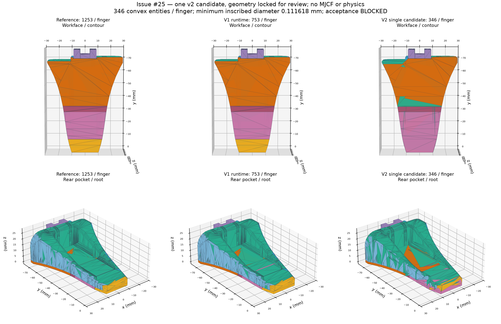

# Issue #25：唯一一版 v2 runtime partition

**最终状态：`V2_RUNTIME_ENTITY_PARTITION_BLOCKED`。** 已实际生成一个候选并停止，未追加第二版。最小实体尺度和原关键工作面检查通过；独立 union exterior 认证未通过，A/B 双向表面与法向验收不完整，protected void 不能全部宣告通过。因此这份 JSON 是待审查的失败候选，不能用于正式 MJCF。

任务：[最新评论](https://github.com/LeoandDream/Nero_Gripper_assets/issues/25#issuecomment-6268780857)。基线 `12e0762d86c1a2f42f14090b19ef70e63ce556e3`；规则直接读取 **`8a5518b37f15678893ca6f540f5ef2edea199ab8`** 的 Git blob，SHA256 `4ffb096f2519fed41d8d45c9c0b4ed3ec4dc781f959d4f0420905ce8b5df999b`。没有修改 tier、预算、protected void 或原始资产。当前基线里的规则文件只与该 blob 存在分类文件 SHA 元数据差别，规则语义相同；两份文件原样保留。

## 实际产物与规模

每指 **346 个闭合凸多面体**，双指复用为692个；相对1253 reference减少907个（72.39%），相对753 v1减少407个（54.05%）。旧129个薄实体均有映射，最终没有小于0.1mm的实体。74个 Tier C 旧实体身份全部退休；**身份退休不代表其相关 A/B 表面或新的 closure 自动获豁免**。

| 主语义族 | 每指数量 |
|---|---:|
| distal_tip_contact | 4 |
| inner_main_contact_plate | 7 |
| inner_ramp_contact | 7 |
| inner_transition_contact | 3 |
| sidewall_negative_x | 32 |
| sidewall_positive_x | 38 |
| outer_chassis | 137 |
| mount_root | 118 |

跨区实体按主语义族计数，完整 `semantic_features`、来源实体/三角片、相邻实体与并集三角片归属保存在[JSON](nero-gripper-v2-runtime-partition.json)；[CSV](nero-gripper-v2-runtime-partition.csv)与[reference/v1→v2映射](nero-gripper-v2-runtime-mapping.json)便于逐项核查。主族颜色只是组织归属，不表示把源工作面改成其他物理面。



构造复用已有 source-safe 分区，按语义邻接合并；40处薄体以内置于原材料的固定100µm立方锚调整内部 closure。所有凸包与原材料固定49.99µm偏移包络比较，未按后续表面检查移动几何。首次 offset-oracle 三角化出错发生在候选生成前，修正为同一顶点集的 Manifold convex hull；候选只输出过一次。之后只修正分析脚本，没有修改候选顶点或面。

冻结后几何 SHA256（`[[id,vertices_m,faces],...]` 的 Python `json.dumps(..., separators=(',',':'))` UTF-8字节）：
`79bef01f443035c6db2213c0e73531c079cdb97762361e682d7c9d052edac84e`。

## 通过的局部检查及其边界

| 项目 | 实际结果 | 范围 |
|---|---|---|
| 最小最大内切球直径 | **0.1116176202mm，PASS** | 独立 LP 重算全部346个凸体，阈值0.1mm，无 tier 豁免 |
| main/tip/ramp/shoulder | **6组工作面检查 PASS** | 原功能连通片的轮廓上界≤`2.034e−7mm`，平面偏差≤`1.153e−7mm`，法向偏差≤`5.652e−5°`；只说明这些已接受工作面未被重新设计 |
| 旧168条 A 异常点 | **168/168≤10µm**，最大 **2.930170µm** | 从原采样记录复原位置，对本次布尔并集输出重新查询；不是整体外壳认证 |
| 材料集合双向距离 | 保守上界 **49.99µm，PASS** | 原三份 STL 的实际并集与 v2 双向固定 cube-offset Boolean difference 均为空；包含数值核误差说明 |
| 74个 C 实体身份 | **全部退休** | 不再保留对应的一对一薄实体；C 域来源豁免未全部认证通过 |

材料双向距离通过不等于表面距离通过：内部 closure 微缝/伪面可以几乎不改变材料体积，却产生远离原外壳的网格边界。未偏移的 `source−v2` 仍有约`2.392e−6mm³`，因此也没有宣称内缩为零。

## union exterior 与 A/B 认证阻断

确实以 double-precision Mesh64 Boolean union 提取了 v2 边界：**2234顶点、4372三角片、6558边**；网格有向闭合，每边出现两次，布尔核返回 NoError。数据见[NPZ](nero-gripper-v2-union-exterior.npz)，单位mm；包括原始 STL 真正并集、源面索引及候选边界归属。**没有把所有 closed-cell triangles 当外露面**。

但闭合网格/库成功退出不足以认证真实并集外壳。另一套凸面投影覆盖、输出归属和遮挡检查给出 **334条认证失败（268条输入外露覆盖缺失、66条输出归属不完整），21条遮挡疑点**；最大未覆盖面积约`2.9364e−5mm²`。这可能包含数值退化，不能直接称为相同数量的真实孔洞。同时记录105组同向多所有者面、总面积17.44468mm²；这是几何重复归属，未进行接触或力求解。

一个可复核反例：输出边界三角片2940上的点 `(6.599999964, −64.424873631, 7.798575050)mm`，距**全部**原始源外壳最近也有 **0.619918918mm**，最近源面711（B），不能用冻结 C 域50µm范围豁免。邻近 V20218/V20221 的反向 closure 平面仅在浮点极小量上分离。**仍不能区分真实表示微缝与布尔/数值伪面，不能据此宣布真实0.620mm物理缺陷。** 反例与半空间余量见[JSON](nero-gripper-v2-runtime-counterexample.json)。这正是独立 exterior 认证不能跳过的原因。

以下指标只描述**尚未独立认证的布尔输出边界**，不冒充最终真实外壳的 Hausdorff 证书。C 面只在固定源域与溯源条件满足时剔除，新 closure 保守继承相邻 A/B。A 继承域可能偏保守，但上述0.620mm反例对任意源表面也超 B 预算，不依赖把它指定为A。

| target / 方向 | 最大实测下界mm | 连续保守上界mm | 判断 |
|---|---:|---:|---|
| A source→v2 | 0.008786633 | 0.009779414 | 此方向满足0.01mm |
| A v2→source | 5.798574955 | 5.798575096 | 输出边界验证 FAIL |
| B source→v2 | 0.040949624 | 30.037888102 | **UNKNOWN**，上界过松；不是观察到30mm误差 |
| B v2→source | 5.066781254 | 13.062198497 | 输出边界验证 FAIL；上界过松 |

A 法向对应覆盖 source→v2 有38片未覆盖，v2→source有348片未覆盖。已可靠对应部分最大差 **0.044572774°**，不能据此声称整个A法向通过；**整个A的最大法向误差 UNKNOWN**。A/B全局轮廓及双向表面认证均未完成。必需的独立 exterior 认证失败后，不再无限细分其余误差上界；保留完整有限检查、连续保守界和 UNKNOWN，没有用有限采样判整体 PASS。

## protected void

结论 **未全部通过（BLOCKED / UNKNOWN）**，没有修改规则解释以放行。

- 原源空域向内收缩50µm后的连续 core 保留，由材料外扩49.99µm包络证明。两条原0.15mm side channels因此保留至少其50µm core；原冻结通道见证保持。
- 五个 backing bores 的25条连续通路、背袋9条连续开口线段均保持畅通；没有仅用孔中心一个点判通。
- 四安装盲凹座、central bore core、root slot 共131个冻结占据见证保持；四凹座轴线上底面推进为0。root/main主要缺口的原空域 core 保留。有限见证与连续 core 证明不替代所有命名结构完整的边界尺寸/拓扑认证。
- **中央孔的全装配贯通要求存在源资产矛盾**：mount 零件有孔，但指定跨接口的轴线及4条偏置线在原冻结完整装配中已被 backing 阻挡，v2同样阻挡，没有新增封堵。本轮不能擅自把“全贯通”改成“仅零件有孔”，也不能挖通源材料来通过。完整 through-path 状态保持 UNKNOWN/源约束冲突。

详见[材料、空域和关键工作面报告](nero-gripper-v2-material-voids.json)。新的 closure 不在 C 域内的部分未获吸收授权；不以材料距离通过替代 C 源域资格。

## 复核命令与留档

实际科学环境：Ubuntu22.04，Python3.11.9、NumPy1.26.4、SciPy1.15.3；任务私有 `debug/issue25/v2-runtime/vendor` 中 Manifold3D3.5.4、Shapely2.1.2。绘图环境为已有 Python3.11.16 / Matplotlib3.10.3。未安装/修改系统依赖。布尔工具来源：[Manifold](https://github.com/elalish/manifold)；独立覆盖核查仍另行执行，未把库声明当验收证明。

在仓库根目录，使用已有环境和已保存候选执行：

```bash
OPENBLAS_NUM_THREADS=1 OMP_NUM_THREADS=1 \
  /data_robot/projects/.worktrees/nero-gripper-grasp-diagnosis/.venv/bin/python -B \
  scripts/verify_v2_runtime_partition.py
OPENBLAS_NUM_THREADS=1 OMP_NUM_THREADS=1 \
  /data_robot/projects/.worktrees/nero-gripper-grasp-diagnosis/.venv/bin/python -B \
  scripts/verify_v2_material_voids.py
/data_robot/projects/.experiments/nero-official-contact-audit-20261018/.venv/bin/python -B \
  scripts/draw_v2_runtime_partition.py
```

已执行生成命令为同一科学 Python 运行 `scripts/build_v2_runtime_partition.py`，退出0。该脚本拒绝覆盖已有候选，只能在独立的新复核副本重建，**不要删除原候选或历史目录来重跑**。4个程序最终均退出0；验证程序退出0表示报告生成完成，报告状态仍为 BLOCKED。中间分析脚本报错、修正及未完成收紧的日志均保留，不能误读为每次分析都首次成功。

任务原始目录：`/data_robot/projects/.worktrees/nero-gripper-runtime-partition/debug/issue25/v2-runtime/`，含原规则blob、依赖安装日志、构造计划、运行日志、候选验证前冻结SHA、连续覆盖证据缓存、分析修正前日志。可携带的核心证据已随本提交保存：候选JSON/CSV、映射、实际union NPZ、验证JSON、材料/void JSON、反例、对比图以及[版本/命令/SHA清单](nero-gripper-v2-runtime-provenance.json)。详细[验证报告](nero-gripper-v2-runtime-verification.json)保留逐实体尺度、129条映射、168点和表面失败证据。

本轮没有生成正式MJCF，没有导入MuJoCo、调用collision query、执行积分/抓取、修改active model或物理控制参数，没有改冻结规则。原19份机械输入及旧实验/工作树保持原状。

**停止于 `V2_RUNTIME_ENTITY_PARTITION_BLOCKED`。下一步唯一建议：由 ChatGPT 独立审查 closure 拼接与并集认证反例，以及冻结中央贯通要求和原装配几何的一致性；本轮不再改几何，不进入MJCF。**
